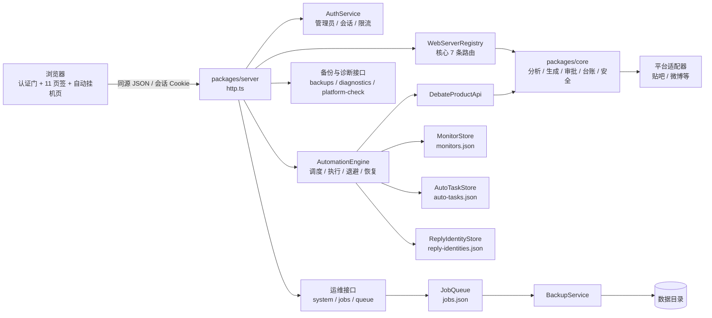
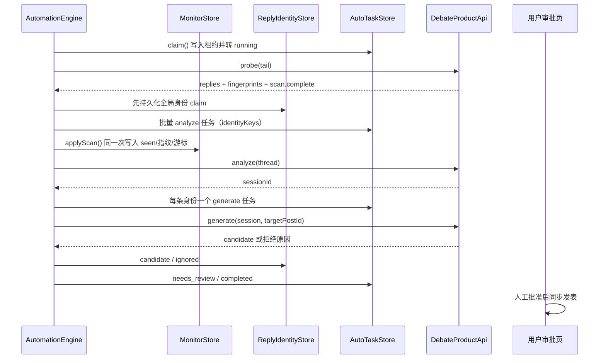

# AI Debate v0.2.2 系统架构（as-built）

> 状态：按最终冻结候选实现整理，B1–B4 与 Soak/持久化架构复审 **IS_PASS YES**；全新连续 24h Soak 正在运行。**当前仍为 NO-GO，且不是发布签字**，正式 Release 还必须完成本文 §11 的待回填项。
>
> 版本：`0.2.2`（根目录与三个 workspace 的 `package.json` 一致）
>
> 证据基线：UTC 2026-11-21 12:03:04 的最终冻结候选；运行环境 Node.js `22.22.2`，CI 固定 `22.18.0`。`engine.ts` SHA256 为 `5323c87bc66306ba1e825fcf0ab0a5994afd754d05f977c6667f685225307c1c`，冻结清单见 `.tmp-data/soak-v022-continuous-final-20261121T120304Z/freeze.txt`。
>
> 相关文档：[可靠性](./reliability-v0.2.2.md)、[安全审计](./security-audit-v0.2.2.md)、[升级验收](./upgrade-v0.2.2.md)、[发布说明](./release-notes-v0.2.2.md)、[验收报告](./acceptance-v0.2.2.md)。

## 1. 范围与不可逾越的边界

v0.2.2 是单机、单管理员的讨论分析与回复工作台。它在 v0.2.1 的存储可靠性、补偿扫描和任务台账基础上，补齐全局回复身份、任务租约、备份恢复中心、运维诊断与部署加固。

三条边界在代码层强制，而不是仅靠文档约定：

1. **core 不依赖 server**。后台能力通过 `packages/core/src/product-api.ts` 的窄接口调用核心已有实现。
2. **后台接口没有发表能力**。`DebateProductApi` 只有 `resolveUrl/probe/analyze/generate/session/sessionForThread/ownerIdentity`，没有 publish；维护队列的 `JobType` 也是封闭集合。
3. **候选停在 `needs_review`**。真实发表仍须登录用户在审批页生成一次性批准并同步执行，不进入后台队列，不自动重试。

## 2. 组件与分层



| 层 | 主要文件 | 职责 |
|---|---|---|
| Web | `packages/web/src/entry.cjs`、`automation-panel.cjs`、`static/*` | 认证门、继承的 11 页签、自动挂机与备份中心、诊断导出 |
| HTTP | `packages/server/src/http.ts` | Host/同源/JSON 围栏、认证、核心路由转发、运维与备份 API |
| 组合根 | `packages/server/src/app.ts` | 按顺序装配存储、队列、核心、监控引擎、HTTP 与定时备份 |
| 核心 | `packages/core/src/*` | 读取、分析、生成、候选、审批、发表验证、安全与核心台账 |
| 后台 | `monitor/engine.ts`、`store.ts`、`tasks.ts`、`identities.ts`、`migrate.ts` | 监控调度、游标、任务状态机、租约、全局身份、启动迁移与 orphan 修复 |
| 备份 | `packages/server/src/backup.ts` | 白名单快照、SHA-256 清单、校验、恢复前快照、回滚与轮转 |
| 部署 | `packaging/linux/*`、`packages/server/src/cli.ts` | Windows 启动器/守护、Linux systemd、路径策略、日志轮转与卸载 |

运行时 server 与 core 没有第三方运行时依赖；React 只打进 Web 静态资源。Node 官方二进制提供 HTTP、加密、文件与 SEA 能力。

## 3. 启动、挂载与停机

`startServer()` 的顺序固定：

1. `layoutOf()` 解析唯一数据目录，`ensureLayout()` 创建 `backups/`、`logs/`、`run/`。
2. 创建日志与审计；Windows 上尽力收紧数据目录 ACL。
3. 加载配置、凭据与管理员；凭据 `load()` **不会**新建密钥。
4. 创建维护队列并恢复中断任务；`backup.restore` 崩溃后置 `failed`，不盲目重跑。
5. 加载监控、任务与全局身份台账；恢复 `running` 任务并记录模型调用是否不确定；在引擎启动前完成旧回复身份迁移，迁移失败时自动化与核心/手工分析接口熔断。
6. `apply(host.ctx, config.raw, { storeDir, onReady })` 挂载核心，注册 7 条核心路由。
7. 初始化静态资源、HTTP 服务、实例记录；仅在产品挂载成功且身份迁移成功时启动 `AutomationEngine`。
8. 启用自动备份：启动 30 秒后（已有 `state.json` 时）与每 6 小时一次。

受信 Host 由绑定地址和 `AI_DEBATE_TRUSTED_HOSTS` 显式推导，绝不从请求头扩宽。`0.0.0.0` 只扩大监听范围，不自动信任网卡地址。

停机顺序：停止定时备份 → 停止后台引擎（最多等待 4 秒）→ 停止维护队列（abort + 4 秒宽限）→ 关闭 HTTP → 清理本进程的 run/instance 记录。正常停止退出码 `0`；受控重启退出码 `75`。

## 4. 数据目录与持久化契约

数据目录优先级：`--data-dir` → 绝对路径 `AI_DEBATE_HOME` → 平台默认。

| 文件 | 内容 | v0.2.2 说明 |
|---|---|---|
| `config.json` | 用户显式配置 | 同一对象原地更新，核心每次重新解析；写前检测外部修改冲突 |
| `credentials.json` / `credentials.key` | AES-256-GCM 密文 / 32 字节密钥 | 密钥独立保存；备份只含密文 |
| `admin.json` / `sessions.json` | scrypt 口令哈希 / 会话 id 的 SHA-256 | 不进入备份 |
| `state.json` | 核心会话、候选、批准、发表去重、验证与用量 | 核心台账 |
| `jobs.json` | 维护任务队列 | 备份、恢复、轮转、凭据审计、存储自检 |
| `run/job-receipts.json` | 维护任务终态 receipt | 恢复成功后绕过被还原的 `jobs.json`，重启后合并展示；上限 2 MiB/50 条/40 日志 |
| `monitors.json` | 监控目标、基线、seen、指纹、游标与计数 | v0.2.1 起 version 2 |
| `auto-tasks.json` | 后台任务、模型调用与租约 | v0.2.2 起记录 `leaseToken/leaseExpiresAt/heartbeatAt` |
| `reply-identities.json` | 全局回复身份 | v0.2.2 新增，stable/fallback 两种键空间 |
| `backups/<name>/` | 白名单文件 + `manifest.json` | 目录暂存后一次 rename 发布 |
| `logs/`、`egress.jsonl` | 脱敏运行日志、审计与出网记录 | 不进入备份 |

`writeFileAtomic()` 的顺序是：写临时文件并处理短写 → `fsync(file)` → 按需复制 `.bak` → `rename` → POSIX `fsync(dir)`。`AtomicWriteError` 区分 `disk_full/permission/io`。监控、后台任务与身份台账都遵守“先落盘、再采纳内存”。

核心 `state.json` 另有跨进程锁：每次获取随机 token，写前重新验证 token，release 以 rename+CAS 只删除自己的锁。其他活进程的锁永不被年龄回收；同 PID 但未注册在 `activeLockTokens` 的 token 视为已结束临界区的孤儿，可立即回收。清理诊断不改变已成功 persist 的结果。

候选证据使用 durable-only 边界：`readPersistedSnapshot()` 等待本实例 writeChain，再持锁读取磁盘，且不把 dirty 内存覆盖到持久视图；产品 API 与 Soak harness 都从该持久事实判断候选是否存在。`absent` 与 `unavailable` 严格区分。幽灵候选恢复先写 identity `ignored`，再写 task `failed`；若任务写失败，下一轮由 ignored 身份栅栏仅补任务终态，不重读核心、不调用模型。monitor 候选计数只在正常生成路径确认持久候选后增加；超时恢复、孤儿对账和既有候选复用不得再次累计。新回复发现采用 identity → analysis task → monitor cursor 的持久顺序；任务写入失败时游标不得推进。

## 5. 自动挂机流水线



### 5.1 读取策略

`probeThread()` 提供三种模式：

| 模式 | 范围 | 用途 |
|---|---|---|
| `tail` | 首页 + 末两页；最多 12 楼、每楼最多 3 页楼中楼 | 常规轮询 |
| `window` | 从末页向前，直到整页早于时间窗口；最多 8 页 | 补偿扫描，默认回看 24 小时，可配 0–168 小时 |
| `full` | `collectThread()`，受 `maxFloorPages` 限制 | 手动全量重查 |

一次 probe 另有 48 次请求总预算。顶部楼层不完整、错页、空页、预算耗尽都会设置 `scan.complete=false` 与 `incompleteReason`。楼中楼被截断单独记录为 `nestedTruncated`，不会假装完整，也不会因此永久阻塞顶部楼层游标。

### 5.2 游标与补偿

- `seen` 与指纹记录“已经看过”，不完整扫描也会记录已看到的回复，避免下一轮重复入队。
- 只有 `scan.complete=true` 才更新 `lastCompleteScanAt`；不完整扫描不会声称已覆盖到该位置。
- 指纹由种类、作者、正文、时间与父楼层计算，**不含页内顺序**。
- 编辑记为 `changed`，只记录差异，不重新生成候选。
- 只有 `full` 扫描才能判定 `deleted`；尾部或窗口读取不能证明旧回复不存在。
- 补偿扫描发现的真正新回复仍进入分析与生成；编辑不进入生成。

### 5.3 全局回复身份

`ReplyIdentityStore` 的键与监控、会话无关：

```text
stable:<platform>:<threadId>:<postId>
fallback:<platform>:<threadId>:sha256(规范化内容)
```

贴吧楼层与楼中楼暴露持久 post id，使用 `stable`；其他适配器只有经验证后才能声明稳定 ID，否则使用 `fallback`。fallback 不能区分编辑与新回复，这一限制由 `identityQuality` 明确表达。

身份状态为 `claimed → candidate | ignored`。新回复的持久顺序是 identity → analysis task → monitor cursor：身份 claim 先落盘，分析任务随后落盘，最后才推进 seen/指纹/游标。任务写入失败时本次扫描直接失败，游标不得推进，探针任务保留 running 并交给租约恢复；若身份已写而任务缺失，orphan sweep 能重新排入分析。若任务已存在，持久任务键阻止重复。第二个监控看到同一回复时得到同一身份与 `fresh:false`。

启动时，`migrateLegacyReplyIdentities()` 在引擎观察监控前从 v0.2.1 的 `seen`、游标指纹、任务与核心候选重建身份。身份文件不存在时原子创建；已存在时不覆盖新证据；旧任务缺 key 时可幂等回填。`state.json` 损坏、监控/会话上下文冲突、非法候选、未知任务 kind 或多个已批准候选冲突时迁移熔断，不写出不完整身份或回填任务，也不写迁移完成标记。持久完成标记让同源重启无写入，源变化只做安全增量。身份或监控源台账不可读时，服务与 `/healthz` 保持可用，但自动化与核心/手工分析接口熔断并报告 `identityMigrationError`，避免以空身份栅栏重放旧回复。

身份台账对 `candidateId` 执行严格结构校验；engine 不直接信任该字段，而是回到核心会话核验候选归属与上下文。非法值被拒绝，不能伪造候选证据。

批量分析任务携带 `postIds/identityKeys`。后续身份可追加到尚未运行的批次；批次已运行时，新身份另开一批，不会静默丢失。

### 5.4 租约、心跳与 orphan sweep

- 任务 claim 写入随机 `leaseToken`、`leaseExpiresAt` 与 `heartbeatAt`，默认租约 10 分钟。
- 调度 tick 为所有 in-flight 任务续租；错误 token 不能续租。
- 租约过期任务由 `reapStuck()` 置 `failed`，释放槽位；若曾有模型调用，标记 `uncertain`。
- 进程重启把 `running` 恢复为 `pending`、attempts+1、清除旧租约；未完成模型调用标记 `interrupted_uncertain`。
- 启动时与运行中每 30 秒执行 orphan sweep：把“身份已 claim、任务却缺失”的回复重新排入分析。
- 身份进入 candidate 后，还会对账 candidate 与 completed analyze 双台账：`candidateId` 仅作核心 session 提示；`markCandidate` 成功而 analyze 写失败时，无模型调用也能把 analyze 收敛到 `needs_review`；核心已有候选时直接复用，`markCandidate` 写失败则保持 completed/claimed 等待下次对账，不丢候选证据；await 后/finish 前重查 `needs_review`，防止异步审核恢复竞态。
- 终态任务不会继续占用身份：active 集合只计真正覆盖工作的状态；failed generate 无候选时收敛为 `ignored`，人工 retry 仍可恢复；completed analyze 命中候选时 analyze 转 `needs_review`，不创建 generate、不调用模型。

租约是单实例部署下的持久活性信号，**不是分布式锁**。`run/instance.lock` 只是防误开的实例记录，不宣称多实例安全。

### 5.5 失败分类

| 平台响应 | 后台动作 |
|---|---|
| 429 / `rate_limited` | 尊重 `Retry-After`；无则指数退避 + 抖动 |
| 401 / 403 / captcha / permission denied | 暂停该监控并记录 `blockedReason`，不重试 |
| 网络错误 / 超时 / 5xx | 有上限的指数退避 |
| `EgressBlockedError` / 出网策略拒绝 | 原样传播、不重试、不发表；监控显示策略阻断 |
| 404 / 结构损坏 | 永久失败 |
| 模型安全拒绝 | 记录原因并标记身份 `ignored`，不反复调用模型 |
| 台账写入失败 | 停止领取新任务，进入 30 秒冷却降级；状态中心显示原因 |

贴吧能力矩阵中的 `supported` 只表示该能力曾于 2026-10-27 在真实帖子跑通，**不表示当前网络可达**。当前解析仍依赖硬编码选择器；页面结构变化可能被误报为“帖子删除/未登录”，且三个真实夹具尚未接入回归测试。诊断面板会显示状态，但“尚未探测”不等于“健康”。

## 6. 备份与恢复

### 6.1 白名单

`BACKUP_FILE_NAMES` 固定为七项：

```text
config.json
state.json
jobs.json
monitors.json
auto-tasks.json
reply-identities.json
credentials.json
```

明确排除 `credentials.key`、`admin.json`、`sessions.json`、`run/`、`logs/` 与 `egress.jsonl`。`credentials.json` 是密文，但备份整体仍按敏感数据保管。

manifest 记录每项 SHA-256、字节数、类型、创建时间、`containsCredentials` 与 `credentialKeyId`（密钥文件的非秘密 SHA-256 指纹）。创建拒绝旧 `config.json` 中的明文 `tiebaCookie/llmApiKey`。

### 6.2 恢复顺序

1. 校验备份名、manifest、白名单、普通文件类型、大小与 SHA-256。
2. 决策凭据：无密钥则跳过 `credentials.json`；指纹匹配则恢复；指纹不匹配则拒绝整个恢复。
3. 空间预检：按当前/备份较大集合的四倍加 manifest 余量估算峰值。
4. 创建并校验 `pre-restore-*` 快照。
5. 逐文件临时复制 + rename；备份中不存在的 live 文件不删除。
6. 全部替换后再次校验 SHA-256 并解析 JSON。
7. 写恢复记录；恢复任务的成功终态与日志写入 `run/job-receipts.json`，`GET /api/ai-debate/jobs` 合并展示该 receipt；成功回调触发受控重启（退出码 75）。恢复后的 `jobs.json` 保持与备份逐字节一致，不被旧队列 finally 回写。

任何后续校验失败都会回滚本次已替换文件，并尝试恢复原 manifest。恢复前快照中的旧明文配置会被清理，损坏原文另存到数据目录留证。恢复期间后台引擎停止、维护队列暂停并暂时挂起 `jobs.json` 持久化，防止旧队列 finally 覆盖恢复结果；失败后自动恢复队列持久化与运行状态，并真正重启后台引擎，任务错误保留原始恢复失败上下文。成功恢复的终态与日志通过 `run/job-receipts.json` 保留，避免被还原后的 `jobs.json` 覆盖。

自动轮转只删除通过完整校验的 daily/weekly 备份：daily 保留 7 份、weekly 保留 4 份；manual、pre-restore、损坏或不可验证备份永不自动删除。

## 7. HTTP 表面

统一前缀 `/api/ai-debate`。全局顺序为：安全响应头 → Host 白名单 → 同源检查 → 写请求 JSON 检查 → 认证/路由。

| 方法 | 路径 | 认证 | v0.2.2 作用 |
|---|---|---|---|
| GET/POST | `/backups` | 会话 | 列表 / 创建 manual、daily、weekly 备份任务 |
| POST | `/backups/:name/verify` | 会话 | 完整 SHA-256 校验 |
| POST | `/backups/:name/restore` | 会话 + `confirmed:true` | 排队恢复，成功后重启 |
| GET | `/diagnostics` | 会话 | 导出无秘密诊断 JSON envelope `{ok:true,diagnostics:...}`；浏览器自行命名下载，不依赖服务端 attachment 头 |
| POST | `/automation/monitors/:id/platform-check` | 会话 | 只读平台探测，不推进游标 |
| GET | `/automation/status` | 会话 | 心跳、队列、身份、备份摘要、监控与待审核列表 |
| GET/POST | `/system/status`、`/system/action` | 会话；状态/停止/重启另可本机 control token | 运维状态与动作 |

本机 control token 仅允许回环 Host 下的状态查询、停止与重启；不能访问备份、诊断或自动挂机接口。`/healthz` 保持免认证，只返回存活、版本与 uptime。

平台 HTTP 出网使用 manual 逐跳重定向：每一跳在 `fetch` 前重新执行出网策略，跨域剥离凭据并隔离 `Set-Cookie`，`EgressBlockedError` 不重试、不发表。全模式私网/回环/link-local/metadata 拒绝、HTTPS 降级拒绝与跨域 307/308 正文拒绝已通过 Core 227/227。

B1 DNS 固定已修复并通过 B1–B4 复审：首次 socket lookup 解析并固定 A/AAAA 地址，后续连接复用该地址；生产 fetch 使用传入 dispatcher 时，同源重定向不重复解析，且第二跳不得增加 resolver 调用，实际 socket 继续复用首次固定地址；重定向到新 host 时逐跳重新执行出网策略与地址校验；出网策略变严时即使 host 未变也重新验证。精确边界：`isPinned` 仅在至少一次成功通过策略校验的 socket lookup 后返回 `true`；自定义/注入 fetch 若忽略 dispatcher，就不会触发 `PinnedDnsAgent` 的真实 socket lookup，既不能固定地址，也不能依靠 `isPinned` 跳过后续预检。代理/TLS 选项不会继承到固定 Agent，CookieJar 仍无 Domain/Path/Secure/过期属性。

## 8. Web 控制台

- 认证外壳：首启、登录、会话失效退回登录页。
- 继承页面：11 个配置/工作流页签保持不变。
- 自动挂机页：全局暂停/恢复、监控增删改、立即检查、只读登录检查、补偿/全量扫描、回看窗口、任务重试/取消、错误区、待审核区、备份中心与诊断导出。
- 统计区共 10 张卡，含“不确定任务”；平台状态区分七态。`status.identities` 已由服务端提供，但当前页面不渲染该字段。
- `secureCookies` 没有 Web UI 开关；只通过 CLI/env 控制，默认 `false`。
- 页面只展示服务端返回值；未知数字显示“—”，不伪造零。备份 HTTP 202 只表示入队，页面轮询到真实终态后才报告成功或失败。
- 页面隐藏时停止状态轮询；后台引擎不受浏览器关闭影响。

## 9. 部署与常驻

| 机制 | Windows | Linux |
|---|---|---|
| 前台/守护 | `serve` / `supervise` | systemd `Type=simple` |
| 异常重启 | 1s→30s 退避；退出码 75 立即重启；0 不重启 | `Restart=on-failure` + `SuccessExitStatus=75` + `RestartForceExitStatus=75` |
| 自启 | 可选 `HKCU\...\Run\AIDebate`，带 `--no-browser` | `systemctl enable` |
| 停止 | control token → 退出码 0 | SIGTERM → 退出码 0，systemd 不重启 |
| 日志 | 内置 2 MB 轮转 + `.1` | 内置轮转 + logrotate weekly/rotate 4/maxsize 10M/copytruncate |

Linux 路径策略将 prefix 限制在 `/opt/ai-debate` 或 `/usr/local/ai-debate` 下，data 限制在 `/var/lib/ai-debate` 或 `/srv/ai-debate` 下，conf 限制在 `/etc/ai-debate` 下；三个规范化路径不得相同或嵌套。安装/卸载脚本解析 unit/env 时不 source/eval，拒绝符号链接逃逸、空白、控制字符与 systemd/shell 元字符。安装写入 root:root `0640` 的 `/etc/ai-debate/.install-paths`（测试模式在测试根目录）；普通卸载保留该元数据，确认 purge 后删除，确保自定义路径在后续彻底卸载时仍可定位。卸载默认保留数据与配置，彻底删除必须 `--purge --confirm-purge`。

`copytruncate` 是没有日志 reopen handler 下的刻意选择，代价是 truncate/append 之间可能丢失少量日志。

## 10. 可核验的实现位置

| 主题 | 代码 | 测试 |
|---|---|---|
| 全局身份与批量分析 | `monitor/identities.ts`、`monitor/engine.ts`、`monitor/migrate.ts` | `packages/server/test/identities.test.ts`、`migrate.test.ts`、`startup-migration.test.ts`、`test/acceptance/automation.ts` |
| 租约与崩溃恢复 | `monitor/tasks.ts` | 同上、`test/acceptance/recovery.ts` |
| 游标与分页 | `monitor/store.ts`、`core/src/probe.ts`、`tieba/adapter.ts` | `test/acceptance/paging.ts`、`core/test/tieba-paging.test.ts` |
| 备份恢复 | `server/src/backup.ts`、`app.ts`、`http.ts`、`jobs.ts` | `server/test/backup.test.ts`、`backup-http.test.ts`、`job-receipts.test.ts` |
| 诊断与 Cookie | `app.ts`、`http.ts`、`cli.ts` | `backup-http.test.ts`、`job-receipts.test.ts` |
| HTTP 出网与重定向 | `core/src/platforms/http.ts`、`core/src/net-audit.ts` | `core/test/platform-http.test.ts`、`net-audit-egress.test.ts` |
| Linux 策略 | `packaging/linux/common.sh`、`install.sh`、`uninstall.sh` | `test/acceptance/linux-path-policy.sh`、`linux-install.sh` |
| 可恢复 Soak | `test/stress/soak-v022.ts`、`scripts/run-soak.mjs` | `test/support/soak-faults.ts`、Soak 自测 |

## 11. 待最终验收回填（当前不得视为通过）

| 项目 | 当前状态 | 发布前必须回填 |
|---|---|---|
| 最终架构复审 | **IS_PASS YES，B1–B4 与 Soak/持久化阻断全部关闭**；只放行冻结候选进入 24h Soak，不等于正式发布签字 | 正式 Tag 保持相同实现与证据 |
| v0.2.1 → v0.2.2 全局身份自动迁移 | **已接线并通过**。迁移 20/20、身份 13/13、启动集成 5/5，合计 38/38；真实升级 97/97（`migrated`，`modelCalls=0`） | 最终候选测试结果与 CI `upgrade-real` 链接 |
| 24 小时 Soak | 最终冻结候选于 UTC `2026-11-21T12:05:15.222Z` 启动，`monitors=1000`、`seed=1`、`kill-every=300`、`seconds=86400`；状态目录 `.tmp-data/soak-v022-continuous-final-20261121T120304Z/`。**正在运行，尚无最终报告** | 连续 24h 报告、墙钟时长、重启/杀死、不变量、峰值与结论 |
| Soak/持久化发布阻断 | **已修复并复审通过**。durable-only 候选证据、同 PID 孤儿锁回收、token CAS release、幽灵候选无模型收敛、unavailable fail-closed、identity-before-task 写序、恢复候选不重复计数、identity → analysis task → cursor 发现写序 | 最终 24h Soak 与 CI 复验 |
| v0.2.2 CI | **全 job 通过**：运行 `44907546464`，提交 `a119b5d0772c77cd62c9058dbeb2e6ee87ac64fb` | 最终 Tag 与 Release 工作流复验 |
| 正式 EXE/TGZ | CI 已构建最终双平台资产并通过版本、standalone/launcher、Node 基线秘密扫描、Ubuntu 22/24 systemd 生命周期与 Debian 12 兼容；既有本机 Windows EXE 为最终修复前资产，已解除资格 | 下载后 SHA256、GitHub digest、安装/恢复复验与 Latest 校验 |
| 真实贴吧/微博账号 | 未验证 | 实号只读/限流/认证/嵌套读取结果；未验证能力继续保持 unavailable |
| Windows 注册表自启 | launcher 1/1 通过，但注册表自启被本机安全策略阻断，未计通过 | 可写主机上的开启/关闭/重启结果 |
| Debian systemd | 仅计划二进制兼容与无 init 安装验证 | Debian 12 真实 systemd 生命周期结果，或明确接受未覆盖 |
| 类型检查与差异检查 | 最终冻结候选 `tsc --noEmit`、`git diff --check`、`git diff --cached --check` 均通过 | 最终 Tag 与 CI 上复验记录 |

B1–B4 架构签字前启动的 `.tmp-data/soak-v022-final-20261121T063026Z/` 已停止，不能作为连续 24h 证据。

最终验收记录由 `docs/acceptance-v0.2.2.md` 汇总；本文只描述架构与证据边界，不替代该签字。
