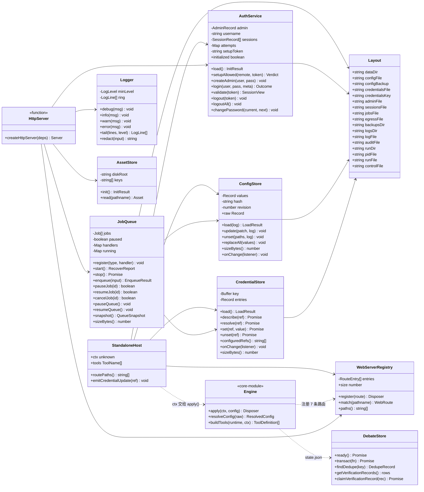
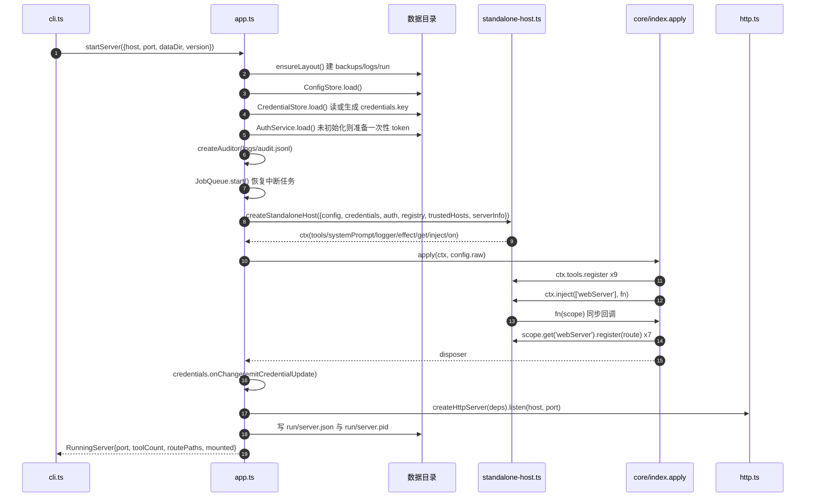
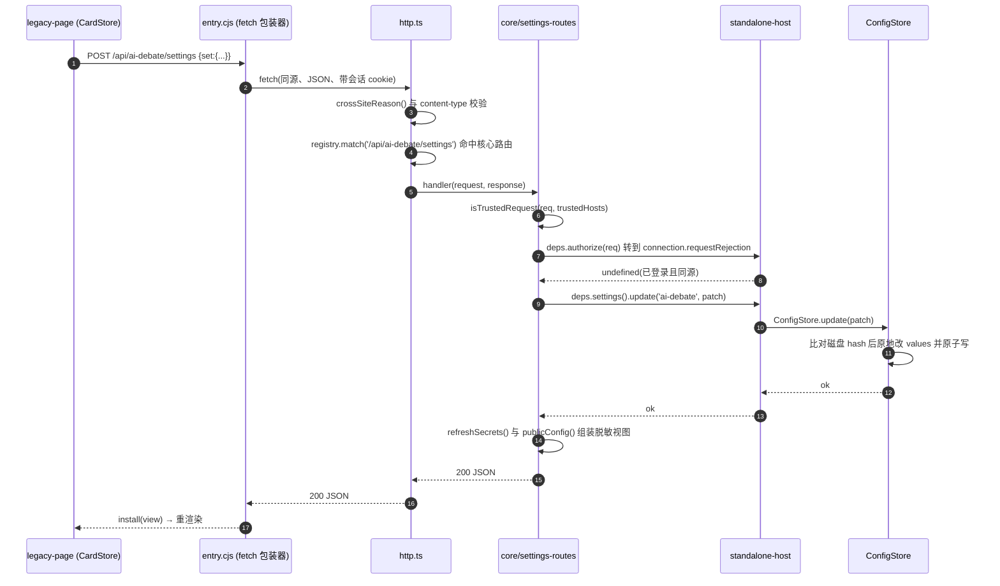
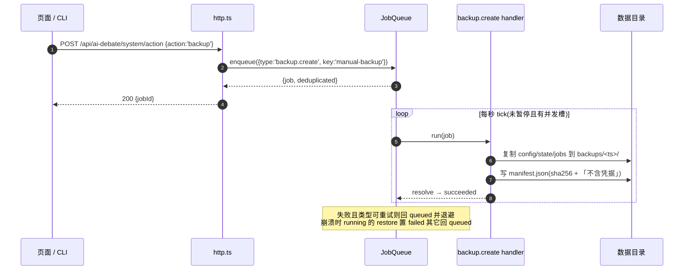
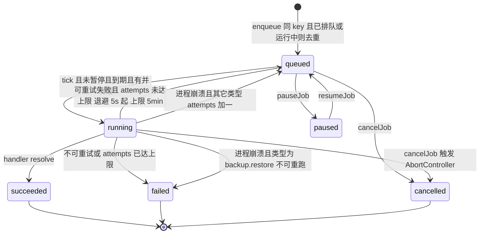
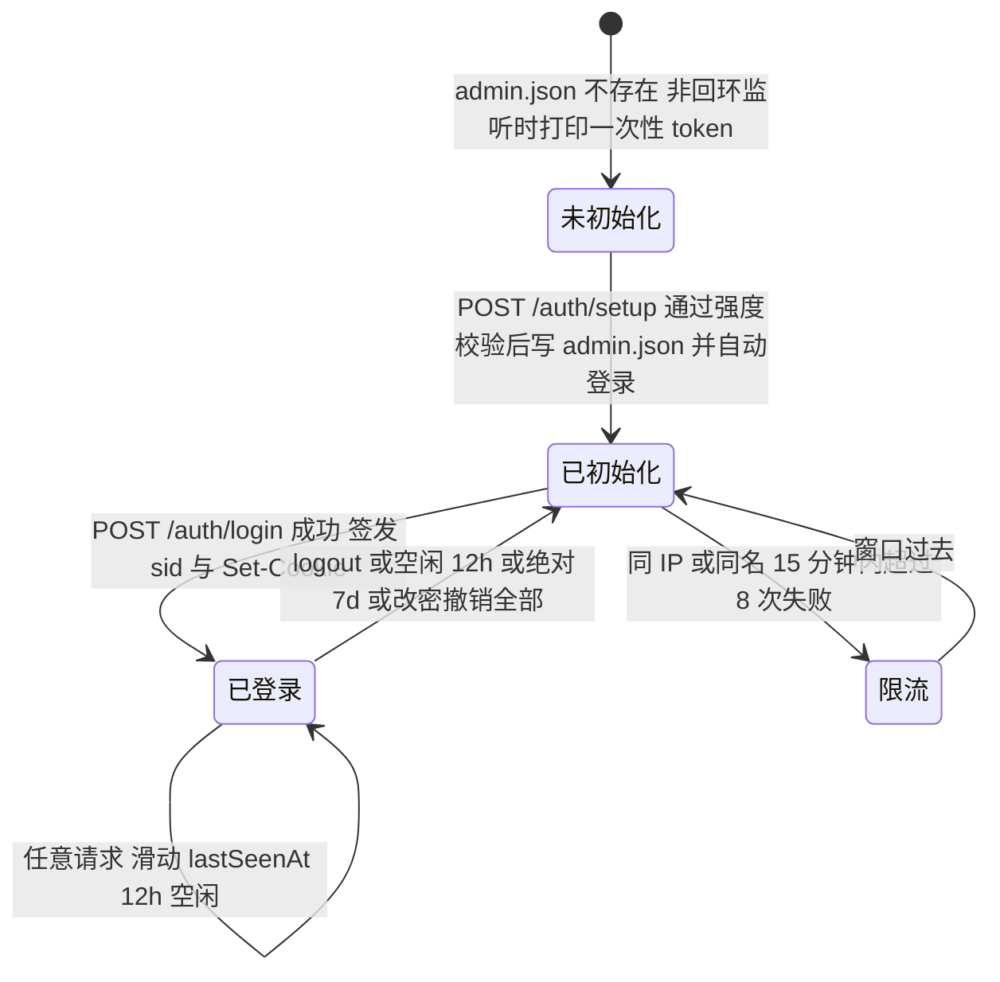
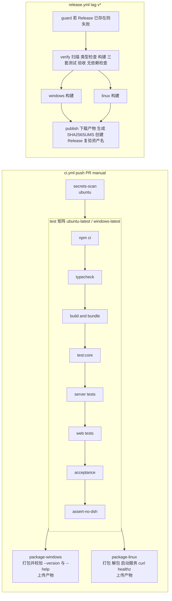

# AI Debate v0.1.0 系统架构设计（as-built）

> 状态：**v1.1，按已落地的实现校准**（工作区 `ai-debate`）
> 作者：架构师 高见远
> 读者：实现工程师、验收人、后续维护者
> 相关：[`task-plan.md`](./task-plan.md)（实现顺序与验收）、[`decisions.md`](./decisions.md)（ADR）、[`security.md`](./security.md)（对外威胁模型）、[`migration.md`](./migration.md)（旧数据迁移）


> **实施偏差说明（发布时补充）**：本文件是设计阶段的方案与任务分解。实际实现中有几处按交付时的判断做了调整，以 `docs/differences.md` 与 `docs/known-issues.md` 为准：
> 1. 任务队列只承载维护类任务（备份/恢复/日志轮转/凭据审计/存储自检），**不承载**分析、生成、发表；`apply()` 未新增第三参数 `hooks`。
> 2. 认证不强制 `x-ai-debate-csrf` 自定义头，改为「同源 + `application/json` + `SameSite=Strict`」。
> 3. 监听地址允许自定义（`--host`），默认仍是 `127.0.0.1`；没有「非回环直接拒绝」。
> 4. 前端主视图使用 `DebateCard`（11 个页签），不是把全部区域堆叠的 `DebateSection`。
> 5. 页面外壳是最薄的普通 DOM，没有引入第二个 React 应用，也没有 hash 路由。


---

## 0. 一句话结论

**保留 `packages/core` 的装配根 `apply(ctx, config)`，为它实现一个「独立宿主」上下文适配器**：把上游约 5.1 万行（89 个文件、含密集注释）、经过大量测试锤炼的业务逻辑（分析/生成/发表/审批/台账/安全）原样搬进独立产品。独立运行时（认证、配置持久化、加密凭据、任务队列、HTTP、静态资源、单实例控制）全部住在 `packages/server`，只通过适配器与核心交互。前端**用确定性脚本转换 7102 行 CJS 页面 + 新写一层壳**，不重写页面。打包用 **Node SEA**：EXE 与 Linux 二进制都不要求用户安装 Node。

三条不可逾越的规则：

1. **core 不 import server**（依赖单向）。
2. **业务只有一个出口**：核心的 `settingsRouteDeps`。server 不另建业务入口，队列也不调业务函数。
3. **发表永不进队列、永不自动重试。**

与本设计最初版本的差异集中在 §13；每一条都写了为什么现在的做法更好、或必须补什么。

---

## 1. 难点与选型

### 1.1 七个核心难点

| # | 难点 | 本质 | 应对（已落地） |
|---|------|------|----------------|
| D1 | 约 5.1 万行宿主耦合代码怎么搬走 | `apply()` 约 2700 行，其中 `settingsRouteDeps` 约 1000 行是产品的**全部**业务 API 面；重写等于重做 40 多个安全相关的接线决定 | 适配器（`standalone-host.ts`，203 行）承接 7 个服务（含 `appServer`）与 `tools`/`systemPrompt`/`logger`/`effect`/`get`/`inject`/`on`；`apply()` 的装配逻辑一行未改 |
| D2 | 配置写入后如何立即生效 | 核心在挂载时拿到 config **引用**，之后每次 `resolveConfig(raw)` 重新解析；换对象 = 冻结在启动值 | `ConfigStore.raw` 是**同一个对象**，`update()` 原地改属性；适配器的 `settings.update/mutate` 转发到它 |
| D3 | 异步凭据 / 同步读取 | `resolveConfig` 同步，凭据存储异步；核心已有 `CredentialMirror` | 实现 `CredentialSeam` 4 个方法即可；`onChange` → `emitCredentialUpdate` 让核心立即重建适配器 |
| D4 | 7102 行前端不能重写 | 11 页签、502 条文案、`CardStore` 25 个方法、4 组三态读模型、30+ 个历史 UI 缺陷的修复注释 | 脚本按**字符串偏移**切出工厂体（不用正则）+ 7 条带次数断言的改写；`new Function` 做语法校验；生成物入库 |
| D5 | 发表不可撤销 | 发出即无法回滚；核心用「单次批准记录 + 先写后发的去重台账」兜底 | 发表**同步、人工在场**，走核心 `/action`；队列只做家务（备份/轮转/审计/体检），`backup.restore` 崩溃后置 `failed` 而非重跑 |
| D6 | 单文件里放 Web 资源 | SEA 只支持内嵌 assets、不能加载原生 addon | 4 类资源走 `sea.getAsset('web/…')`；**零原生依赖**；配置/凭据/台账都是普通文件 |
| D7 | 首启到可登录之间没有会话 | 引导态是经典漏洞窗（谁先 POST 谁当管理员） | 未初始化时：loopback 对端可直接初始化；**非回环监听**必须出示启动时打印的一次性令牌；初始化后接口关闭 |

### 1.2 选型（含否决理由）

| 领域 | 选择 | 理由 | 否决 |
|------|------|------|------|
| HTTP | `node:http` + 自研路由（`registry.ts` 63 行） | 核心的 `WebRoute` 只有 exact/prefix 两态；需要静态资源 + 认证 + 约 20 条自有路由。零依赖 = SEA 包体与供应链都可控 | express/fastify：+3~5 MB、多一层 body 语义（与核心自带 `readJsonBody` 冲突）、无收益 |
| 前端构建 | esbuild 0.25 | 单依赖、毫秒级、能直接把 CJS 工厂体打成 IIFE | Vite：为 2 个页面引入 dev server 与 200+ 依赖 |
| 打包 | Node SEA + postject | 官方路径、无需编译 Node、`node:sea` 读内嵌资源 | pkg（已归档）、nexe（从源码编译 Node，20–40 分钟/平台） |
| 持久化 | JSON + 原子写（tmp→fsync→rename）+ `.bak` | 单用户数据量 MB 级；核心 `DebateStore` 已是这套（含跨进程锁） | SQLite：原生依赖 → SEA 不可用 |
| 口令 | `scrypt` N=16384, r=8, p=1, keylen=64, salt 16B | 零依赖、内存硬、参数随记录保存可升级 | bcrypt/argon2：原生模块 |
| 凭据 | AES-256-GCM + `credentials.key`（0600）+ AAD 绑 ref | 防误传/备份泄漏；纯 `node:crypto` | 系统钥匙串（`keytar` 是 .node）、口令派生（与开机自启冲突） |
| 测试 | `node --experimental-transform-types --test` | 核心测试直接 import `lib/*.js`（tsc 产物），零改动复用上游测试风格 | vitest：要改 import 路径 |
| 队列 | 单文件 JSON + 1 个 tick 定时器 + 单飞 | 家务任务少（≤200），无需外部状态 | BullMQ/Redis：多一个服务，产品是单机 |

### 1.3 分层

```
packages/web      浏览器：外壳（认证门/顶栏/服务灯，原生 DOM）+ 继承页面（React，11 页签）
      │  HTTP /api/ai-debate/*
packages/server   独立运行时：http.ts（认证 + 路由 + 静态）｜ jobs.ts ｜ auth.ts ｜ config-store ｜ credential-store ｜ registry ｜ standalone-host.ts
      │  适配器（唯一接缝）
packages/core     业务内核：index.apply ─ runtime ─ analyzer/generator/publisher/store ─ platforms/security/import ─ settings-routes（7 条路由）
```

---

## 2. 目录结构与文件清单（as-built）

### 2.1 仓库根

| 路径 | 说明 |
|------|------|
| `package.json` | workspaces `packages/{core,server,web}`；脚本 `typecheck/build:core/build:web/build/bundle/package:{windows,linux}/test/test:core/start/smoke`；devDeps：typescript、esbuild、postject、jsdom、@types/node；deps：react/react-dom（打进 web bundle，不进运行时） |
| `package-lock.json` | 入库；当前 lock 只含 `packages/core` 一个 workspace（`web`/`server` 还没有独立清单，见 §13.3） |
| `tsconfig.json` | typecheck 覆盖 `packages/core/src`、`packages/server/src`、`apps/desktop/src`、`test` |
| `.gitignore` | `node_modules/`、`dist/`、`packages/core/lib/` |
| `README.md` / `LICENSE`（AGPL-3.0-only）/ `NOTICE`（上游来源声明） | 用户与合规 |
| `docs/` | `architecture.md`、`task-plan.md`、`decisions.md`、`security.md`、`install-windows.md`、`install-linux.md`、`migration.md`、`release-notes-v0.1.0.md` |

### 2.2 `packages/core`（89 个 `.ts`：88 迁入 + 1 新增）

```
packages/core/
├─ package.json          # @ai-debate/core；exports "." "./host" "./settings-routes" "./config" "./store"
├─ tsconfig.json         # rootDir src / outDir lib；产物保留（测试 import lib/*.js）
├─ src/
│  ├─ index.ts           # ★ name='ai-debate'；apply(ctx, config?)；导出 Config/DEFAULT_CONFIG/resolveConfig
│  ├─ config.ts          # ★ 仅换 import：@deepseek-ai/schemastery → ./schema.js
│  ├─ schema.ts          # ＋ 零依赖 schema 构建器（object/string/number/boolean/const/union + default/min/max/role/volatile）。只描述、不校验
│  ├─ settings-routes.ts # ★ ROUTE_PREFIX='/api/ai-debate'；DEFAULT_TRUSTED_HOSTS 四名；deps.trustedHosts / serverInfo 可选注入
│  ├─ secrets.ts         # ★ COOKIE_REF/LLM_KEY_REF 改 AI_DEBATE_*；LEGACY_* 常量仅用于显式导入；RESERVED 含 4 个
│  ├─ platforms/credentials.ts # ★ 命名空间前缀 AI_DEBATE_
│  ├─ store-dir.ts       # ★ configured→AI_DEBATE_HOME→平台默认；source: configured|env|default；legacyDshStoreDir 仅探测
│  ├─ diagnostics.ts     # ★ APP_VERSION（+ PLUGIN_VERSION 别名）：SEA 'package.json' → import.meta 兜底 → 0.0.0-unknown
│  ├─ host.ts            # ★ 新增 AppServerService + appServerOf（让 server 注入 trustedHosts 与 info）
│  ├─ tools.ts           # 仍含 'dsh-ai-debate' 日志名与文案（§13 缺口 G3）
│  └─ 其余 78 个文件       # 原样（runtime/publisher/store/analyzer/generator/persona/safety/platforms/import/security/…）
└─ test/                 # 8 个测试文件 + helpers.ts + fixtures/（上游 234 个基线里可迁移的部分）
```

**改动统计**：10 个文件有实质改动（新增 1），其余 78 个逐字节原样。

### 2.3 `packages/server`（14 个文件）

见 §2.3.1 与 §4。文件级职责：

| 文件 | 行数 | 职责 |
|------|------|------|
| `cli.ts` | 412 | 命令分派：`serve`/`status`/`stop`/`restart`/`logs`/`open`/`autostart on/off`/`--version`/`--help`；`DEFAULT_PORT=17860`；启动时探测 `/healthz`。**只导出 `runCli`，不自执行**（见 G9-residual） |
| `app.ts` | ~480 | 组合根；`startServer()`；`trustedHostsFor()`；自动备份（6h + 启动 30s 后首次，保留 7 份）；`setAutostart()`（HKCU Run，值名 `AIDebate`）；5 个 job handler；`legacy.scan/import` |
| `paths.ts` | 88 | `Layout`（17 个路径）；dataDir 解析顺序；`ensureLayout()` |
| `atomic.ts` | 91 | `writeFileAtomic`（fsync→rename→备份）；`writeJson`；`readJsonQuarantine`（损坏文件改名另存，不静默重建） |
| `config-store.ts` | 177 | 持有**同一个** raw 对象；hash 冲突检测；`update/unset/replaceAll`；`sizeBytes` |
| `credential-store.ts` | 231 | AES-256-GCM；ref 白名单 `AI_DEBATE_*`；`describe/resolve/set/unset`；`onChange`；`configuredRefs` |
| `auth.ts` | 375 | scrypt；`SESSION_COOKIE='ai_debate_session'`；会话表（哈希存储、12h/7d、最多 8 条）；双维限流；`setupAllowed`；`createAdmin`/`changePassword`/`logout`/`logoutAll`；审计接线 |
| `jobs.ts` | 364 | 5 种家务任务；去重；退避（5s→5min）；200 上限；崩溃恢复；暂停/取消；`snapshot` |
| `logger.ts` | 121 | 级别、环缓冲 500、文件、`redact()`（BDUSS/SUB/sk-/AI_DEBATE_/api_key/password）、`tail()` |
| `audit.ts` | ~90 | 审计：append-only JSONL，写入前 `redact()`；13 类事件 |
| `assets.ts` | 124 | SEA `getAsset('web/…')` 或磁盘 `dist/web`；manifest 列 key；MIME；`immutable` 判定 |
| `registry.ts` | 63 | `WebServerRegistry`：核心注册的 `WebRoute`；exact 优先、prefix 最长优先 |
| `standalone-host.ts` | 203 | ★独立宿主适配器（§4） |
| `http.ts` | ~520 | HTTP 表面：`/healthz` → 跨站/JSON 校验 → `/auth/*` → 核心路由 → `/system/*`、`/jobs*`、`/queue` → `/system` 状态页 → 静态 → 404 |

### 2.4 `packages/web`

```
packages/web/
├─ vendor-legacy-client.cjs     # 上游成品，只读输入（7102 行）
├─ src/
│  ├─ legacy-body.cjs           # ★由 scripts/build-web.mjs 生成（切片 + 7 条改写 + new Function 语法校验）
│  ├─ snapshot-store.cjs        # 40 行：getSnapshot/subscribe/set；无 Immer、无深冻结
│  └─ entry.cjs                 # 704 行外壳：宿主 shim（让 apply 跑起来注入样式）、认证门、顶栏、服务灯、fetch 会话守卫、退出
├─ static/
│  ├─ index.html                # #shell > #app-root；theme.css + app.js(defer)；无内联脚本
│  ├─ theme.css                 # 9839 B：补齐 14 个 --dsw-alias-*（浅/深色）+ 外壳样式
│  └─ assets/                   # app.js(~318 KB, IIFE/minify/es2020) + app.js.map + theme.css（**产物已入库**，见 G16）
└─ test/render.test.mjs         # 真实 HTTP + jsdom 渲染冒烟（BASE_URL 127.0.0.1:17860）
```

### 2.5 `apps/desktop` 与 `packaging`、`scripts`、CI

```
apps/desktop/src/main.ts        # 28 行：runCli(process.argv.slice(2))，唯一入口，打包时从它出发布包

packaging/windows/build.mjs     # 收集 dist/web（含生成的 manifest.json）→ sea-config → blob → 复制 node.exe → postject → dist/AI-Debate-windows-x64.exe + .sha256
packaging/linux/build.mjs       # 依赖 dist/ai-debate.cjs + dist/web → stage dir → tar.gz → .sha256
packaging/linux/install.sh      # /opt/ai-debate/bin + /var/lib/ai-debate + /etc/ai-debate + systemd；--purge 才删数据
packaging/linux/uninstall.sh    # 默认保留数据
packaging/linux/ai-debate.service # ProtectSystem=strict / ProtectHome / ReadWritePaths / Restart=always / NoNewPrivileges

scripts/build-core.mjs          # tsc → packages/core/lib（rm -rf 后全量，不用 incremental）
scripts/build-web.mjs           # 切片 + 7 条改写 + esbuild + 复制 theme
scripts/scan-secrets.mjs        # 提交内容里的凭据形态扫描（BDUSS/SUB=2A25/sk-/Bearer/私钥/gh?p_/AKIA）
scripts/assert-no-dsh.mjs       # 四查：无 @deepseek-ai import｜清单无依赖｜无旧 API 前缀｜打包二进制在无 DSH 环境下可 --version

.github/workflows/ci.yml        # secrets-scan → test（ubuntu+windows 矩阵）→ package-windows / package-linux（needs test）
.github/workflows/release.yml   # guard（Release 已存在即失败）→ verify → windows/linux → publish（sha256sum → gh release create → 再验资产名）
```

---

## 3. 数据结构与接口（as-built）

### 3.1 类图



### 3.2 适配器实际提供的服务表

| `ctx.get(name)` | 值 | 核心里的消费者 |
|-----------------|-----|----------------|
| `settings` | `{ writable:true, update(ns, patch), mutate(ns, ops) }` → `ConfigStore` | `settingsRouteDeps.settings()`（决定设置页是否可写） |
| `credentials` | `CredentialStore`（实现 `CredentialSeam` 4 方法） | `findCredentialSeam` → `CredentialMirror` |
| `connection` | `{ requestRejection({headers}), isLocal({socket}) }` | `deps.authorize` → 7 条路由的第二道闸 |
| `webServer` | `WebServerRegistry`（`register(route) → disposer`） | `ctx.inject(['webServer'], …)` |
| `paths` | `{ dataDir }` | `store-dir.ts` 的 host 探测（若核心将来读取） |
| `appInfo` | `{ name:'AI Debate', version }` | `appServerOf` / 状态面板 |
| `appServer` | `{ trustedHosts, info() }`（`trustedHostsFor(host, env)` 推导 + `AI_DEBATE_TRUSTED_HOSTS` 追加） | `trustedHosts` 注入信任围栏；`serverInfo()` 供状态面板显示进程事实 |
| `llm` | **永远 `undefined`** | `hostLlmOf` → 模型来源回落到自配 OpenAI 兼容客户端 |

`ctx` 的 5 个成员：

```ts
ctx.tools.register(def)      // 收集 name，返回真 disposer（供 --version/状态面板报告「9 个工具」）
ctx.systemPrompt.section()   // no-op + noop disposer（没有 agent 要公告）
ctx.logger(name)             // 转发到 Logger（忽略 name 前缀，统一打码）
ctx.effect(fn, label?)       // 同步执行；收集 disposer；返回幂等 disposer
ctx.get(name, strict?)       // 永不抛；未知名 → undefined
ctx.inject(deps, fn)         // 同步立即调用一次；scope.get 同 get；scope.effect 同 effect
ctx.on(event, listener)      // 仅 'credentials/reference-updated'；吞掉监听器异常
```

### 3.3 配置：`config.json`

```jsonc
{
  "values": { /* 只存用户显式设过的字段 */ },
  "revision": 3,          // 每次成功写入 +1（内存计数；文件 hash 才是冲突判据）
  "writable": true
}
```

- `ConfigStore.raw` 是**同一个对象**，`update()` 原地改属性 —— 这是「改完立刻生效、不用重挂」的全部机制。
- 冲突检测：写前比对磁盘文件 sha256 与上次读到的 hash；不一致 → 抛 conflict（页面已有 `409 → conflict` 文案）。
- 损坏文件：改名 `<file>.corrupt-<ts>` 另存，**保留证据**，用空配置启动并记 warn。
- 字段白名单与类型强制由**核心**的 `EDITABLE_FIELDS` + `coerceField` 负责；server 不做第二套校验（两份清单会漂移）。

### 3.4 凭据：`credentials.json` + `credentials.key`

```jsonc
// credentials.json（0600）——整体不是密文，而是"每个 ref 一个密封条目"
{ "version": 1, "entries": { "AI_DEBATE_TIEBA_COOKIE": { "iv": "…", "tag": "…", "data": "…" } } }
```

- AES-256-GCM；`iv` 12 B 随机；AAD = ref 名 → 把 A 的密文搬到 B 会解密失败。
- 密钥 32 B 随机，`credentials.key`（Linux 0600；Windows 用 icacls 收紧，失败只告警）。
- ref 白名单 `AI_DEBATE_*` + `[A-Z0-9_]`：未知 ref 直接抛，防止核心将来加字段时写错命名空间。
- `describe()` 只回答 `configured/source/writable`——**不回长度、不回尾部四位**（上游那套 `length/tail` 的 DTO 在核心仍存在，但本产品的 store 不提供额外信息，页面因此不会显示「已配置 · 长度 0」这类谎言）。
- `onChange(ref)` → `app.ts` 接到 `host.emitCredentialUpdate(ref)` → 核心 `refreshSecrets()` → 重建适配器。

### 3.5 管理员与会话：`admin.json` + `sessions.json`

```jsonc
// admin.json（0600）
{ "version": 1, "username": "owner", "salt": "b64", "hash": "b64", "iterations": 16384, "createdAt": "…", "updatedAt": "…" }
// sessions.json（0600）——只存 idHash，磁盘被读不等于会话被劫
{ "version": 1, "sessions": [ { "idHash": "sha256(token)", "username": "owner", "createdAt": "…", "lastSeenAt": "…", "expiresAt": "…", "userAgent": "…" } ] }
```

Cookie：`ai_debate_session=<32B hex>; Path=/; HttpOnly; SameSite=Strict; Max-Age=43200`（TLS 时加 `Secure`）。
会话：12h 空闲 / 7d 绝对 / 最多 8 条（超出淘汰最旧）。
限流：per-IP 与 per-username 双维，15 分钟窗口内 8 次，超限 429 + `Retry-After`（内存计数；重启清零 —— §13 风险 R6）。

### 3.6 队列：`jobs.json`

```jsonc
{ "version": 1, "paused": false, "jobs": [
  { "id": "uuid", "type": "backup.create", "key": "manual-backup",
    "state": "queued", "attempts": 0, "maxAttempts": 3,
    "createdAt": "…", "updatedAt": "…", "nextRunAt": "…",
    "payload": {}, "logs": [{ "at": "…", "level": "info", "message": "…" }] }
] }
```

`JobType`（封闭集合）：`backup.create` / `backup.restore` / `logs.rotate` / `credentials.audit` / `storage.check`。
`RETRYABLE` 只含后四类之外的四个读类任务；`backup.restore` 崩溃后**置 failed**，不重跑。

### 3.7 监听事实：`run/server.json`、`run/server.pid`、`run/control.json`

`server.json` 给人/CLI 读（pid/host/port/version/startedAt/dataDir）；`control.json` 只放 CLI 用的 `token`（0600，进程启停用；HTTP 层只接受 `x-ai-debate-control` 头且仅允许 `system/status`、`system/action`）。

---

## 4. 独立宿主适配器契约（逐成员，含失败模式）

> 总原则：适配器只做**语义翻译**，不替核心做决策。任何一处返回值变宽松，都可能让核心的安全判断失效。

**服务面（7 个，经 `ctx.get(name)` 或直接属性读取）**：`settings`、`credentials`、`connection`、`webServer`、`paths`、`appInfo`、`appServer`（`llm` 永远返回 `undefined`）。
**上下文成员（7 个名字，6 组语义）**：`tools`（工具注册表）、`systemPrompt`（提示段落注册表）、`logger(name)`、`effect(fn,label)`、`get(name,strict?)`、`inject(deps,fn)`、`on(event,listener)`。前两个是对象，后五个是函数；其中 `get`/`inject` 属同一组（服务查找与作用域注入）。

### 4.1 `ctx.get(name, strict?)`

| 项 | 内容 |
|----|------|
| 输出 | 命中服务对象；未知名 → `undefined`；`'llm'` **永远** `undefined` |
| 失败模式 | **绝不抛**。核心有两处把 `get` 当能力探测（`findCredentialSeam`、`hostLlmOf`、`appServerOf`），一次抛错会带走整个挂载（上游 v0.2.36 真实事故） |
| 若返回错误值 | `settings` 缺失 → 设置页变只读（`writable:false`），用户无法保存任何配置；`credentials` 缺失 → 凭据只能从配置字段读，与「加密独立存储」需求冲突；`webServer` 缺失 → 7 条路由不注册，产品不可用；`connection` 缺失 → 核心的 `authorize` 回落 403，所有业务接口关闭 |

### 4.2 `ctx.inject(deps, fn)`

| 项 | 内容 |
|----|------|
| 语义 | 所有服务在挂载前已就绪，故**同步立即调用一次** `fn(scope)`；`scope.get` ≡ `get`；`scope.effect` ≡ `effect`（清理归注入域） |
| 输出 | `fn` 的返回值原样返回（核心不使用） |
| 失败模式 | `fn` 抛错 → **向上抛**（这是挂载失败，`app.ts` 捕获后 `mounted=false`，业务路由 503，但 `/healthz` 仍 200，进程不退） |
| 不实现的后果 | 7 条核心路由永不注册；`routePaths()` 为空，状态面板会如实显示 `engine.routes: []` |

### 4.3 `ctx.effect(execute, label?)`

| 项 | 内容 |
|----|------|
| 语义 | 同步执行 `execute()`；返回值若是函数则登记为 disposer；返回一个**幂等** disposer |
| 失败模式 | `execute()` 抛错 → 向上抛（与 Cordis 一致：效果初始化失败即挂载失败）。`app.ts` 把整个 `apply()` 包在 try/catch，所以一次失败只是「引擎未挂载」，不是「进程崩了」 |
| 不实现的后果 | 核心的 `register()` 走 fallback 分支（直接调用 execute），工具与路由仍会注册，但 disposer 链断裂 → 优雅关闭时不清路由表 |

### 4.4 `ctx.on(event, listener)`

| 项 | 内容 |
|----|------|
| 语义 | 只接受 `'credentials/reference-updated'`；其它事件返回 noop disposer |
| 失败模式 | 广播时逐个 try/catch：一个监听器抛错不影响其它监听器，也不打断凭据写入 |
| 不实现的后果 | 凭据轮换后要等下一次请求才生效（核心有 `ensureSecretsFresh` 兜底），属降级而非故障 |

### 4.5 `ctx.logger(name)`

| 项 | 内容 |
|----|------|
| 语义 | 返回 `{debug,info,warn,error}`，统一转发到 `Logger`（级别过滤 + 环缓冲 + 文件） |
| 失败模式 | 写盘失败降级为内存 + 一条 warn，**绝不因日志失败抛错** |
| 额外 | `redact()` 在落盘前对 BDUSS/SUB/sk-/`AI_DEBATE_*=`/api_key/password 打码；日志里不出现 cookie、key、口令 |

### 4.6 `ctx.tools` / `ctx.systemPrompt`

| 项 | 内容 |
|----|------|
| `tools.register(def)` | 收集**只含 name** 的列表（9 个），返回真 disposer。**没有任何 HTTP 执行入口** |
| `systemPrompt.section(...)` | no-op（没有 agent 可公告），返回 noop disposer |
| 为什么不是纯空实现 | 返回假 disposer 会让核心的清理链假成功；保留 name 列表让状态面板能如实报「9 个工具在册」，这是「业务内核完整」最便宜的证明 |

### 4.7 关键调用流程

**A. 启动与挂载**（`startServer` → 首个请求就绪）



**B. 一次带凭据的设置保存**（页面 → 核心 → 服务端存储）



**C. 一次家务任务（备份）**



### 4.8 生命周期（`app.ts` 实际顺序）

```
startServer(options)
 1. layoutOf(dataDir) + ensureLayout()     建 4 个目录
 2. new Logger(level, logs/server.log)
 3. ConfigStore.load()                     缺文件=首次运行；损坏=另存+空配置
 4. CredentialStore.load()                 读或生成 credentials.key
 5. AuthService.load()                     首次运行→未初始化；非回环→打印一次性 setup token
    5b. createAuditor(logs/audit.jsonl, redact)
 6. JobQueue + 5 个 handler + start()      恢复中断任务（restore → failed）
 7. WebServerRegistry
 8. createStandaloneHost({...})            ★ 适配器（含 appServer.trustedHosts / info）
 9. apply(host.ctx, config.raw)            ★ 唯一挂载点（try/catch → mounted/mountError）
10. credentials.onChange(→emitCredentialUpdate)
11. AssetStore.init()                      0 个资源 = 明确 error 日志（打包缺资源）
12. createHttpServer(...) + listen()
13. write run/server.json + run/server.pid
14. 自动备份定时器（6h + 30s 后首次，保留 7 份）
```

关闭顺序：`clearInterval` → `queue.stop()`（abort running + 4s 宽限 + persist）→ `server.close()` → 删 `run/server.json`、`run/server.pid`。

---

## 5. 状态目录与文件布局（as-built）

选择顺序：`--data-dir` → `AI_DEBATE_HOME`（绝对路径才接受）→ 平台默认：

| 平台 | 默认 |
|------|------|
| Windows | `%LOCALAPPDATA%\ai-debate` |
| macOS | `~/Library/Application Support/ai-debate` |
| Linux | `$XDG_DATA_HOME/ai-debate`（绝对才用）否则 `~/.local/share/ai-debate` |

```
<dataDir>/                     普通运行无需管理员；目录由程序创建
├─ config.json                 + config.json.bak
├─ credentials.json            0600 密文
├─ credentials.key             0600 32B
├─ admin.json                  0600
├─ sessions.json               0600（只存 hash）
├─ jobs.json                   队列
├─ state.json                  ★核心台账（会话/候选/去重/审批/验证/用量/安全事件）+ state.json.bak + state.json.lock
├─ egress.jsonl                核心出网审计
├─ logs/server.log (+ .1)      轮转；redact 后写入
├─ logs/audit.jsonl            安全动作审计（预留，见 §13 G6）
├─ backups/<YYYY-MM-DDTHH-mm-ss>/   每个备份一个目录：config/state/jobs + manifest.json（sha256 + 「不含凭据、口令与会话」）
├─ run/server.json / server.pid / control.json
```

要点：

- **备份是目录 + manifest**，不是单个 tar：可以逐文件校验 sha256，可以人工打开检查。备份**不含** `credentials.*`、`admin.json`、`sessions.json`。
- **恢复先备份自己**：`pre-restore-<ts>/` 目录保留恢复前的三份文件；`backup.restore` 崩溃会被置 `failed`（不重跑），并要求重启以重新加载台账。
- **旧数据（`~/.dsh/ai-debate`）只探测、不自动读取**：`app.ts` 的 `legacy.scan()` 只统计「有没有 / 在哪 / 多少会话与台账」，`/system/status` 的 `legacy` 字段带 `note` 文案。导入必须由用户显式触发（`/system/action` 的 `legacy-import`），且**仅当新台账为空**时才复制，复制前后各留一份（`.pre-import-<ts>` 与原文不动）。凭据**不导入**。

---

## 6. HTTP API 清单（as-built）

统一前缀 `/api/ai-debate`。全局安全头（CSP `script-src 'self'`、`frame-ancestors 'none'`、`nosniff`、`no-referrer`、`DENY`、`same-origin`）。
全局跨站判定（`crossSiteReason`）：`sec-fetch-site: cross-site` 直接 403；`Origin` 存在且与 `Host` 不一致 → 403。
写操作：有请求体时必须 `content-type: application/json`，否则 415（跨站 HTML 表单发不出这个类型）。

| 方法 | 路径 | 认证 | 作用 |
|------|------|------|------|
| GET | `/healthz` | 无 | `{ok, version, uptimeSec}`；launcher/systemd 探活 |
| GET | `/auth/state` | 无 | `{initialized, authenticated, username?, version}`（不泄漏其它） |
| POST | `/auth/setup` | 未初始化 + loopback 或一次性 token | `{username, password, token?}` → 200 + Set-Cookie；已初始化 → 409 |
| POST | `/auth/login` | 无 | `{username, password}` → 200 + Set-Cookie；401 / 429(+Retry-After) |
| POST | `/auth/logout` | 无（凭 cookie） | 撤销当前会话 + 清 cookie |
| POST | `/auth/password` | 会话 | `{current, next}` → 200；**撤销所有会话**，要求重新登录 |
| — | **核心 7 条**（注册进 `registry`，由核心的 `authorize` 自行认证） | 会话（经 `connection.requestRejection`） | 见 §6.1 |
| GET | `/system/status` | 会话 或 control token | `info()`（version/pid/host/port/dataDir/uptime/mounted/mountError/engine/store/legacy）+ `queue.snapshot()` + `session` |
| GET | `/system/logs?lines=&level=` | 会话 | `{lines}`，`lines` 1..2000，`level` 取 debug/info/warn/error |
| POST | `/system/action` | 会话 或 control token | `{action}`：`restart` / `stop` / `backup` / `rotate-logs` / `storage-check` / `credentials-audit` / `autostart-on` / `autostart-off` |
| GET | `/jobs` | 会话 | 队列快照（paused/counts/jobs/concurrency） |
| POST | `/jobs` | 会话 | `{type, key?, payload?}`；只接受 4 种读类任务；队列满 429；同 key 去重 |
| POST | `/jobs/:id/{pause,resume,cancel}` | 会话 | 单任务操作；不允许的状态 → 404 + 原因 |
| POST | `/queue` | 会话 | `{action}`：`pause` 或 `resume` 全局暂停/恢复 |
| GET | `/system` `/system/` | 会话（无会话 → 302 `/`） | 服务端渲染的 HTML 状态页：版本/PID/端口/数据目录/启动时间、队列计数、旧数据提示、最近 80 行日志。**无 JavaScript**（CSP `script-src 'self'`，状态页不应依赖能跑的 bundle） |
| GET | `/` `/index.html` | 无 | `index.html`，`no-store` |
| GET | `/assets/*` | 无 | `app.js`/`theme.css`；ETag + `immutable`（命中 `assets/` 前缀）；`If-None-Match` → 304 |

控制令牌（`x-ai-debate-control`）只允许 `system/status`、`system/action` 两个路径，其它一律 403 —— 它存在的理由是「CLI 没有浏览器会话，但要能停掉自己启动的服务」，而能读数据目录里 `control.json` 的进程本来就有删除 `state.json` 的权限。

### 6.1 核心提供的 7 条（`settings-routes.ts`，前缀已改）

| 方法 | 路径 | 作用 |
|------|------|------|
| GET/POST | `/settings` | 脱敏配置视图 / `{set, unset}` 写入（字段白名单 + 类型强制在核心） |
| POST | `/secrets` | `{ref, value}` 写 / `{ref, clear:true}` 清 |
| GET | `/status` | 实时诊断（平台探测、台账、用量） |
| POST | `/action` | **23 个动作**（实测去重）：`test-llm`、`check-login`、`probe-host-llm`、`probe-egress`、`refresh-platforms`、`preview-personas`、`pause-now`、`analyze-thread`、`generate-candidates`、`publish-approved`、`edit-candidate`、`verify-publish` + `manual-*`（11：preview/confirm/select/revise/context/generate/edit/approve/copy/compare/cancel-compare） |
| GET | `/verification?platform=` | 发表验证视图（无能力 → 501） |
| GET | `/workbench?sessionId=` | 发表工作台读模型（无发布栈 → 501） |
| POST | `/approve` | 创建人工批准记录（**唯一**写入者，需 `expected` 快照） |

### 6.2 明确不做的接口

- **`/tools/:name` 执行口**：独立版没有 agent；开放它等于给外部一个「自带 confirm 的发表通道」，直接破坏「人工批准」语义。
- **远程绑定 + 内置 TLS 终止**：核心围栏的 `trustedHosts` 已支持注入（为反代留了接缝），但 v0.1.0 不提供证书管理 —— 见 `security.md` §6，用反代。
- **多用户 / 角色 / 多租户**：单管理员是产品定位。
- **自动发表 / 批量后台发表**：需求明确人工批准；见 `security.md` §4。

---

## 7. 队列状态机（as-built：家务型队列）



| 规则 | 实际取值 |
|------|----------|
| 任务类型 | `backup.create` / `backup.restore` / `logs.rotate` / `credentials.audit` / `storage.check` |
| 重试 | 仅 4 个读类（restore 不可）；`maxAttempts` 默认 3，可每任务覆盖 |
| 退避 | `5s × 2^(attempts-1)`，上限 5min |
| 并发 | 1（构造可 1..4） |
| 队列上限 | 200（queued+running）；满 → `enqueue` 抛 `queue_full` → HTTP 429 |
| 单任务超时 | 5min → abort → 按可重试失败 |
| 日志 | 每任务最多 40 行（`note(level, message)`） |
| 暂停 | 全局 `paused` 或单任务 `paused`；tick 不取 |
| 崩溃恢复 | `running` → `queued`（attempts+1）或 `failed`（restore），写 warn 汇总 |
| 持久化 | 每次状态迁移 `writeJson(jobs.json)`（原子写 + `.bak`） |

**为什么队列里没有 analyze/generate/verify/publish**：`jobs.ts` 顶部与 `JobType` 的封闭集合就是这条规则的强制实现。分析/生成是「有人点了按钮」的交互动作，走核心 `/action` 同步执行；发表是不可逆写入，交给重试就是重复发帖的来源。

---

## 8. 安全模型（as-built）

### 8.1 威胁与对策

| # | 威胁 | 路径 | 对策（代码位置） | 残留 |
|---|------|------|------------------|------|
| T1 | 首启被本机他进程抢占 | 抢先 POST `/auth/setup` | 未初始化 + loopback peer 直接放行；**非回环监听**必须出示启动日志里的一次性 token（`setupAllowed`）；初始化后 409，token 立刻失效 | 同用户下的恶意进程本就能读 `admin.json`；声明在 `security.md` |
| T2 | CSRF | 恶意网页诱导浏览器 | `SameSite=Strict` cookie + `crossSiteReason`(Origin/Host + `sec-fetch-site`) + 写请求必须 `application/json` | 无 |
| T3 | DNS rebinding | 恶意域名解析到 127.0.0.1 | 核心的 `isTrustedRequest(request, trustedHosts)`：Host 必须**精确等于** `DEFAULT_TRUSTED_HOSTS`（127.0.0.1/localhost/[::1]/::1），且 Origin 存在时必须与 Host 同源；可信主机表由 server 注入，**永不从请求头自动扩宽** | 无 |
| T4 | 凭据泄漏 | 日志/前端/备份/诊断 | 密文落盘；`describe` 只答 configured；日志 `redact()`；备份不含 credentials/admin/sessions；`/system/status` 不含凭据 | 进程内存中的明文 |
| T5 | 越权发表 | 提示注入 + `confirm:true` | 核心已有：单次批准记录（绑定 session+candidate+platform+target+account+bodyHash+version，30min 过期）+ 能力矩阵门 + 导入会话硬拒 + 发表不在队列 | 用户自己点批准（产品设计） |
| T6 | 登录爆破 | 循环尝试 | scrypt(N=16384) + `timingSafeEqual` + per-IP/per-user 15min 窗口 | 计数在内存，重启清零（§13 R6） |
| T7 | 会话劫持 | XSS / 磁盘窃取 | `HttpOnly`+`SameSite=Strict`；磁盘只存 `sha256(id)`；CSP `script-src 'self'`；页面与外壳均不 `innerHTML` | 同用户可读进程内存 |
| T8 | 路径穿越 | `storeDir` / 备份目录名 / 资源路径 | `storeDir` 不在 `EDITABLE_FIELDS`；备份名只接受 `^\d{4}-\d{2}-\d{2}T[\w-]+$`；资源读取拒绝含 `..`/`\` 的路径 | 用户自己能改 config.json（他是主人） |
| T9 | 数据丢失 | 覆盖写 / 恢复失败 / 卸载 | 原子写 + `.bak`；恢复前 `pre-restore-*`；`uninstall.sh` 默认保留数据，`--purge` 才删 | 磁盘故障 |
| T10 | 供应链 | 依赖投毒 | **运行时零第三方依赖**；devDeps 仅 5 个；Node 二进制来自官方 release；CI 跑 `scan-secrets` | Node 本身 |
| T11 | 明文残留 | 同步盘/AV 上传 | AES-256-GCM；密钥 0600 | 同用户可解密（声明为**非目标**） |
| T12 | DoS | 巨大 body / 任务风暴 | body ≤ 1 MiB；队列 ≤ 200；单任务 5min 超时；日志环缓冲 500 | 同用户可 kill |

### 8.2 认证态机



---

## 9. 前端：确定性转换 + 新外壳（as-built）

### 9.1 切片与改写（`scripts/build-web.mjs`）

- **切法**：`indexOf('factory: (require) => {')` 到 `lastIndexOf('return module.exports')`，用字符串偏移，**不用正则**——300 KB 里全是模板字符串，贪婪正则必然吃错区域。任一标记缺失 → 立刻失败，不写半成品。
- **7 条改写**（每条带 `expected` 计数，命中数不符即整次失败）：

| # | 找 | 换成 | 次数 |
|---|----|------|------|
| 1 | `require('@deepseek-ai/dsh-client-store')` | `require('./snapshot-store.cjs')` | 1 |
| 2 | `'/api/dsh-ai-debate'` | `'/api/ai-debate'` | 1 |
| 3 | `'DSH_AI_DEBATE_TIEBA_COOKIE'` | `'AI_DEBATE_TIEBA_COOKIE'` | 1 |
| 4 | `'DSH_AI_DEBATE_LLM_API_KEY'` | `'AI_DEBATE_LLM_API_KEY'` | 1 |
| 5 | `dsh-ai-debate/card.css` | `ai-debate/card.css` | 2 |
| 6 | `tag.dataset.plugin = 'dsh-ai-debate'` | `'ai-debate'` | 1 |
| 7 | `[dsh-ai-debate]`（console 前缀） | `[ai-debate]` | 2 |

- **语法校验**：`new Function('exports','require','module','__filename','__dirname', code)` 立刻解析整段，截断/改写出错在建包时失败，而不是在浏览器里白屏。
- **输出**：`src/legacy-body.cjs`（`module.exports = __factory`），文件头写自动生成警示。**生成物入库**，构建可重复。

### 9.2 外壳（`src/entry.cjs`，原生 DOM）

| 职责 | 实现 |
|------|------|
| 让 `plugin.apply()` 跑起来 | `createHostContext()` 给最小 `effect/locale/slots/logger`；唯一真实作用是执行 `ensureStyles()` 把 `CARD_CSS` 注入 `<head>`。slot 注册是 no-op（没有宿主 shell 可注册进去），但 `effect` 必须真执行回调、`inject/register` 必须返回 callable，否则页面的清理链会拿到 `undefined` |
| 认证门 | `boot()` → `GET /auth/state`：未初始化 → Setup 表单；未登录 → Login；已登录 → 主视图（React 挂载 `DebateCard`）。`/auth/state` 实测只返回 `{initialized, authenticated, version}`（不含 `csrf`，见 G13） |
| 会话失效 | 用 `window.fetch` 包装器（而非改页面）监听：凡是 `/api/ai-debate/*` 且非 `/auth/*` 的 401/403 → 一次性退回登录页。理由：生成的页面自带请求，没有钩子可插；包装器是唯一单一位置 |
| 顶栏 | 品牌、用户名、服务灯（30s 轮询核心 `/api/ai-debate/status`，页面隐藏时暂停）、系统链接（当前指向 `/api/ai-debate/status`，见 G14）、退出 |
| 文本安全 | 全部 `textContent`；**没有任何 `innerHTML`**；服务端消息里的 `<` 原样显示 |

### 9.3 页面与外壳的边界

| 归属 | 内容 |
|------|------|
| 页面（`legacy-body.cjs`） | 11 页签的渲染与交互、`CardStore`、502 条文案、`dsd-*` 样式、7 条核心 API |
| 外壳 | 认证、CSRF 无关（沿用 SameSite+Origin+JSON）、样式注入、会话守卫、服务灯、退出 |
| 禁止 | 外壳不调核心 7 条业务路由（避免两套写路径）；页面不改 cookie、不自建认证 |

---

## 10. 打包与运行（as-built）

### 10.1 管线

```
1. node scripts/build-core.mjs       tsc → packages/core/lib（全量，无 incremental）
2. node scripts/build-web.mjs        切片+改写+语法校验 → src/legacy-body.cjs
                                     esbuild 打包 entry.cjs → static/assets/app.js（IIFE/minify/es2020）
                                     复制 theme.css → static/assets/theme.css
3. node scripts/bundle-server.mjs    收集 packages/web/static → dist/web（含 manifest.json）
                                     esbuild 打包 apps/desktop/src/main.ts → dist/ai-debate.cjs（CJS, external node:sea）
4. node packaging/windows/build.mjs  收集 dist/web（含 manifest.json）→ sea-config → blob
                                     → 复制 node.exe → postject NODE_SEA_BLOB + sentinel fuse
                                     → dist/AI-Debate-windows-x64.exe + .sha256
5. node packaging/linux/build.mjs    同上（linux）→ staging dir → dist/ai-debate-linux-x64.tgz + .sha256
```

### 10.2 资源加载

```ts
// assets.ts（生产/开发同一条 API）
const api = await import('node:sea').catch(() => undefined)   // 非 SEA 的 Node 没有这个模块
if (api?.isSea?.() && typeof api.getAsset === 'function') {
  const manifest = api.getAsset('web/manifest.json')          // 列出全部 key
  ...
  return { body: Buffer.from(api.getAsset(`web/${relative}`)), ... }
}
return readFileSync(join(diskRoot, relative))                  // 开发态：dist/web
```

- 资源 key 前缀统一 `web/`；`manifest.json` 由打包脚本生成（键为 `version` + `assets[]`）。
- 启动时若 `keys.length === 0` → **明确 error 日志**（「打包产物缺少 web 资源」），而不是等到 404。

### 10.3 产物与体积

| 产物 | 内容 | 预估/实测 |
|------|------|-----------|
| `dist/AI-Debate-windows-x64.exe` | Node 22 运行时 + server CJS + web 资源 | ≈ 88–95 MB（本机 node.exe 87 MB + blob） |
| `dist/ai-debate-linux-x64.tgz` | 同上 + `bin/ai-debate` + install/uninstall/service + README | ≈ 45 MB |
| `static/assets/app.js` | 外壳 + 继承页面 + React | 318 KB（minify；含 map 共 ~1.16 MB） |

### 10.4 运行模式（`cli.ts`）

| 命令 | 行为 |
|------|------|
| `ai-debate`（无参） | 已有实例 → 直接开浏览器；否则 spawn `serve`（detached）→ 轮询 `/healthz` → 开浏览器 → 自身退出 |
| `ai-debate serve` | 前台服务（systemd 与 launcher 都用它）；SIGTERM/SIGINT → 优雅关闭 |
| `ai-debate status / stop / restart / logs / open` | 读 `run/server.json` + control token；stop 是 POST `/system/action` |
| `ai-debate autostart on/off` | Windows 写/删 `HKCU\Software\Microsoft\Windows\CurrentVersion\Run\AIDebate`（默认关闭） |
| `--version` / `--help` | 版本（打包二进制读 SEA 资源，其次 `import.meta`，最后 `0.1.0`）与帮助 |

---

## 11. CI 拓扑（as-built）



规则：

- **CI 失败禁止发布**：`release.yml` 的 `windows`/`linux` 都 `needs: verify`，`publish` `needs: [guard, windows, linux]`；任一环失败都不上传。
- **已发布 Tag/资产不得覆盖**：`guard` 用 `gh release view "$TAG"` 探测，存在即 `::error::` + `exit 1`；发布不用 `--clobber`。
- **不发布 latest**：`release-notes` 说明 v0.1.0 为 pre-release（发布能力未真机验证）。
- Node 固定 `22.18.0`；lock 入库；`scan-secrets` 与 `assert-no-dsh` 是**发布准入**的一部分。

---

## 12. 已知取舍与风险

| # | 取舍 / 风险 | 影响 | 缓解 | 残余 |
|---|-------------|------|------|------|
| R1 | 适配器不做 Cordis 的服务热替换 / inject 重入 | 若核心将来依赖「服务重建时再注入」会静默失效 | 当前所有服务在挂载前就绪，语义等价；`host.ts` 注释写明了「只在注入时调用」 | 低 |
| R2 | 转换脚本的 7 条规则是硬编码偏移 | 上游页面若再改，构建失败而非静默半应用 | `expected` 计数 + `new Function` 语法校验；失败即整次构建失败 | 低（会立刻红） |
| R3 | SEA 与 esbuild 的兼容边界 | `import.meta`、动态 require、原生 addon | 零原生依赖；版本走「SEA 资源 → 注入常量 → `0.0.0-unknown`」；`npm run bundle` 已实测产出并跑通 EXE 的 `--version` | 中：Linux 侧只有 CI 能证明 |
| R4 | 发表/验证的不可逆性 | 崩溃后可能已发出 | 发表不进队列；核心的 claim + 去重台账是最后一道；`backup.restore` 也不重跑 | 低 |
| R5 | 多实例写同一数据目录 | 台账互相覆盖 | 核心 `state.json.lock` 保证不会写坏；`run/server.json` 只帮 launcher 复用。**仍无强制单实例锁**（§13 G4 未修）：两个 `serve` 用不同端口都能起来，配置写入会以 409 冲突互相拦住 | 中 |
| R6 | 限流计数只在内存 | 重启后锁定清零 | 攻击者需要能重启本机服务；会话与口令哈希都在盘上 | 低 |
| R7 | 未签名 EXE | SmartScreen「未知发布者」 | 文档说明；预留签名脚本（用户自带证书） | 中（无证书无法消除） |
| R8 | 微博读取依赖外部 `weibo-cli` | 单文件产品无法内嵌第三方 CLI | 保持 `cli_missing`/`not_authenticated`/… 作为**明确状态**，界面直说；贴吧路径不依赖它 | 中（产品能力缺口，非缺陷） |
| R9 | 旧 DSH 数据不合并 | 老用户需重录凭据 | `legacy.scan()` 统计 + `legacy.import()` 仅在空台账时复制（含 `<target>.pre-import-*` 备份）；凭据**不导入**，`migration.md` 写明需重录 | 中 |
| R10 | 备份不含密钥/口令 | 换机需重录 | UI 明示；这使备份可以安全外传 | 低 |
| R11 | ~~根 `npm test` 静默跑 0 个测试~~ → **已修**（G12） | — | 现在串行跑 core 113 + server 20 + web 6 + acceptance 25 项，任一非零即整体非零 | 已关闭 |

---

## 13. 实现现状与偏离（必须读）

> 这一节是把最初设计 vs 已落地的差距逐条写出来。**G 编号是被验收人引用的依据**。

### 13.1 与原设计一致且已完成的

| 项 | 状态 |
|----|------|
| 复用 `apply()` + 适配器（ADR-001） | ✅ `standalone-host.ts`；`apply(host.ctx, config.raw)`；装配代码零改动 |
| 配置热生效 | ✅ `ConfigStore.raw` 原地改属性；核心每次重新 `resolveConfig` |
| 凭据加密 + 事件回推 | ✅ AES-256-GCM + `onChange → emitCredentialUpdate` |
| 命名空间切换 | ✅ 路由前缀 `/api/ai-debate`；`AI_DEBATE_*`；`LEGACY_*` 仅保留常量供显式导入使用 |
| 状态目录独立 | ✅ `--data-dir` / `AI_DEBATE_HOME` / 平台默认；旧目录只探测 |
| 前端转换（ADR-002、ADR-014） | ✅ 切片 + **7 条**改写 + `new Function` 校验 + 40 行快照库；11 页签与 502 条文案原样 |
| 主题令牌 | ✅ `theme.css` 补齐 14 个 `--dsw-alias-*`（浅/深色） |
| SEA 打包（ADR-003） | ✅ 脚本齐备；`manifest.json` + `getAsset('web/…')` |
| Linux 安装/卸载/systemd | ✅ `ProtectSystem=strict` 等加固；默认保留数据 |
| CI 双平台 + 发布不覆盖 | ✅ `guard` + `verify` + 两平台构建 + `publish` |
| 零运行时依赖（ADR-011） | ✅ server 无第三方依赖；core 无 `@deepseek-ai/*` |
| 契约测试 / 端到端验收 | ✅ 实测：core **113**、server **20**、web **6** 全绿；`test/acceptance/standalone.ts` **25/25 通过**（含首启、登录、保存配置、保存 Key 不回显、测模型、导入→生成→编辑→批准→复制、备份任务、重启后会话与台账仍在、路径穿越 404、跨站写入 403） |
| 打包链路 | ✅ 实测 `npm run bundle` → `dist/ai-debate.cjs` 1124 KB + `dist/web`（5 个资源）；`npm run package:windows` 已产出 `dist/AI-Debate-windows-x64.exe`（89.5 MB），`--version` 打印 `AI Debate 0.1.0 (win32-x64)` |
| 旧数据导入 | ✅ `legacy.scan()` + `legacy.import()`：仅空台账、复制前写 `.pre-import-<ts>`、拒绝合并；`/system/action` 的 `legacy-scan`/`legacy-import` 已接 |
| 信任主机注入（G11 已修） | ✅ 适配器现在提供 `appServer: { trustedHosts, info() }`；`--host` 推导 + `AI_DEBATE_TRUSTED_HOSTS` 显式追加。**实测**：`--host 0.0.0.0` + env 列出 `192.168.1.20`/`debate.example.com` → 两者访问 `/settings` 均 **401**（放行，只缺会话）；未列出的 `evil.example.com` → **403**；不设 env 时 LAN Host 仍 **403**（fail-closed） |
| 审计日志（G6 已修） | ✅ `audit.ts`（append-only JSONL，写入前 `redact()`）。**实测**：首启写 `admin.created`、登录写 `auth.login`、错口令写 `auth.login_failed`、停止写 `service.shutdown`，都带 `at` 与主体，且不含明文 |
| 凭据扫描（G10 已修，但有代价） | ✅ exit 0。**方式**是 `scan-secrets.mjs` 的 `ALLOW` 白名单加入了 `packages/server/test/runtime.test.ts`（文件级，不是目录级）——比「跳过所有 test/」小，但仍是一处豁免；见 G10 的残留说明 |
| 根测试命令（G12 已修） | ✅ `npm test` 串行跑四条，实测 core **113** / server **20** / web **6** / acceptance **25** 全绿 |

### 13.2 有意的偏离（比原设计更好）

| # | 原设计 | 实际 | 为什么更好 |
|---|--------|------|------------|
| D-1 | `config-schema.ts` 新字段元数据 | `schema.ts`：一个 170 行的**零依赖构建器**，`config.ts` 只换 import | 原来的 `.default/.min/.max/.union/.role/.volatile` 调用点一个不动 → 零语义漂移；不必维护两份字段清单，也不必用测试锁 `EDITABLE_FIELDS` 与 schema 的一致性（那份清单仍然在核心，仍是唯一写入白名单） |
| D-2 | 外壳用 React（`App.jsx`/`Login.jsx`/…） | 外壳用**原生 DOM**（704 行），只有继承页面用 React | 外壳只有登录/首启/顶栏/服务灯。第二个 React 应用会让 bundle 翻倍，并把认证门的正确性绑到旧页面容器的生命周期上；原生 DOM 让「清空一个节点」与「React 拥有另一个节点」互不干扰 |
| D-3 | 12 条转换规则（含删 `apply`/`exports`） | **7 条改写** + 保留整个 `apply()`，由外壳提供一个**最小宿主 shim** | 不删代码就没机会删错；`apply()` 的真实作用是 `ensureStyles()`，shim 让这一条唯一必要行为保留，slot 注册自然退化为 no-op。生成物行数 ≈ 原文件，验收可以 diff |
| D-4 | 队列承载 analyze/generate/verify，用 `DebateProductApi` 交付 7 个入口 | 队列只做**家务**（备份/轮转/审计/体检），`JobType` 是封闭集合；不存在 `DebateProductApi` | 分析/生成是交互动作，搬进队列会让 UI 状态从「服务端事实」变成「本地推测」；更重要的是，业务仍只有 `settingsRouteDeps` 一个出口（ADR-001 要保护的性质），不必新增第三参 |
| D-5 | 认证用 CSRF 自定义头 | 用 `SameSite=Strict` + `Origin/Host` 同源 + 写请求必须 `application/json` | 生成页面自己发请求，加自定义头要改生成物；而「跨站 HTML 表单发不出 `application/json`」+「`SameSite=Strict` 不随跨站发送」已经覆盖 CSRF，且 `Origin` 校验是浏览器强制的。代价是多一层全局中间件（已实现），收益是不动页面 |
| D-6 | `secrets.json` 单块密文 | `credentials.json` 每 ref 一条密封条目 | 单条损坏不影响其它；改一条不需要重写整块；AAD 绑 ref 使「搬移密文」失效 |
| D-7 | 备份是单个 JSON | 备份是**目录 + manifest.json（sha256）** | 可逐文件校验、可人工打开、可选择性恢复；`backup.restore` 崩溃后不可重跑这一点也有地方写理由 |
| D-8 | 监听 loopback 硬性限定 | `trustedHosts` 可注入（核心已支持），但 CLI 默认 `127.0.0.1` | 为反代（`security.md` §6）留了接缝，同时不自动从 `Host` 头扩宽（DNS rebinding 防线仍在核心） |

### 13.3 缺口（逐条实测；已修 vs 仍开）

> 复核方式：每条都实跑或静态核对过。`已修` 的条目保留了「当时是什么样、怎么验证它真的修好了」，因为验收人需要能复现判断。

#### 已修复（保留验证方法）

| # | 原缺口 | 现状 | 复现验证 |
|---|--------|------|----------|
| G10 | `scan-secrets` 被自己的测试夹具判死（exit 1） | **已修**：`scan-secrets.mjs` 增加 `ALLOW` 白名单（文件级：`scripts/scan-secrets.mjs`、`test/acceptance/fixtures/README.md`、`packages/server/test/runtime.test.ts`） | `node scripts/scan-secrets.mjs` → exit 0，输出「凭据扫描通过（182 个受版本控制的文件）」 |
| G11 | `--host 0.0.0.0` 下核心 7 条路由全 403 | **已修**：适配器提供 `appServer: { trustedHosts, info() }`；`trustedHostsFor()` 从绑定地址推导 + `AI_DEBATE_TRUSTED_HOSTS` 显式追加；`info()` 补齐设置页的进程事实块 | ① 带 `AI_DEBATE_TRUSTED_HOSTS=192.168.1.20,debate.example.com` 启动 `--host 0.0.0.0`，用原生 `http` 发 `Host: 192.168.1.20:<port>` 与 `Host: debate.example.com` 请求 `/api/ai-debate/settings` → **401**（放行）；② 同实例 `Host: evil.example.com` → **403**；③ 不设 env 时 LAN Host → **403**（fail-closed） |
| G9 | `npm start` 指向不存在的 `packages/server/src/main.ts` | **已修**（脚本层）：`start` 改为 `node --experimental-transform-types packages/server/src/cli.ts serve`。**但见下方 G9-residual** | `npm start` 不再 MODULE_NOT_FOUND |
| G12 | 根 `npm test` 静默跑 0 个测试 | **已修**：改为串行四条（`test:core` → `test:server` → `test:web` → `acceptance`） | `npm test` → core **113**、server **20**、web **6**、acceptance **25/25**，exit 0；任一环节失败即非零 |
| G6 | `audit.jsonl` 只有路径没有事件 | **已修**：新增 `audit.ts`（append-only JSONL + `redact()`），接线 `admin.created` / `auth.login` / `auth.login_failed` / `auth.throttled` / `auth.logout` / `auth.password_changed` / `service.shutdown` / `service.restart` / `backup.created` / `backup.restored` / `legacy.scanned` / `legacy.imported` / `autostart.changed` / `settings.write_failed` | 起服务 → 初始化 → 错口令登录 → 停服务，`logs/audit.jsonl` 出现 4 行，字段为 `{at, event, username?, ip?, reason?}`，无明文 |
| G3 | core 有 DSH 命名残留 | **已修**：`tools.ts` 的 6 处已清（`grep -c dsh packages/core/src/tools.ts` = 0）；`store.ts` 的 `defaultStoreDir()` 改为委托 `platformDefaultStoreDir()`，只留一处解释历史的注释 | `grep -rn "dsh-ai-debate" packages/core/src` → 只剩 `store-dir.ts`（legacy 探测，保留正确）与注释 |
| G14 | 顶栏「系统」指向 JSON 接口 | **已修**：`STATUS_URL = '/system'`（人看的状态页）；服务灯改轮询 `HEALTH_URL = /api/ai-debate/system/status` | 点「系统」得到 HTML 状态页；`grep -n "STATUS_URL" packages/web/src/entry.cjs` 指向 `/system` |
| G4 | 无强制单实例锁 | **已修**：`paths.instanceFile = run/instance.lock`；`app.ts` `writeInstance()`/`clearInstance()`；`cli.ts` `liveInstance()`（pid 存活 + `/healthz` 可达 + 1.5s 二次确认，避免把「正在启动」判成「已挂」） | 同一 dataDir 起第二个 `serve`（换端口）→ **exit 3**，打印「已有实例在运行」（实测） |
| G13 | 页面的 CSRF 头是死代码 | **已修**：`grep -c csrf packages/web/src/entry.cjs` = **0**，服务端也为空 —— 前端不再发没人校验的头，注释与实现一致 | 登录 → 改配置 → 存凭据 → 建备份任务全部正常（会话守卫保留，只删 token 注入） |
| G15 | `static/manifest.json` 过期且被跟踪 | **已修**：该文件已删除（`git status` 显示 `D`）；manifest 只剩 `dist/web/manifest.json`（6 项 + `version`） | `npm run build && npm run bundle` 后 `dist/web/manifest.json` 是唯一一份 |
| G9-residual | `npm start` 空转（`runCli` 无模块级调用） | **已修**：既有独立的 `packages/server/src/main.ts`（`runCli(process.argv.slice(2))`），`cli.ts` 也加了 `INVOKED_DIRECTLY` 守卫（`process.argv[1]` 匹配 `cli.(ts|js|cjs|mjs)` 时自执行，被 import 时不执行） | `AI_DEBATE_HOME=<tmp> npm start` → `/healthz` **200**，日志「9 个工具、7 条路由」（实测） |
| G17 | `differences.md` 测试数字略旧 | **已修**：现为「核心 113 + 服务端 20 + 前端 6 + 端到端 25 项」 | `grep -n "核心" docs/differences.md` 与实际测试数一致 |

#### 仍然开着的（发布前判断）

| # | 缺口 | 实测证据 | 影响 | 处理建议 |
|---|------|----------|------|----------|
| **G16** | `packages/web/static/assets/` 的产物仍被跟踪 | `git ls-files packages/web/static` 仍列出 `assets/app.js`(318 KB)、`assets/app.js.map`(873 KB)、`assets/theme.css`；`.gitignore` 里两条 `packages/web/static/app.js*` 已失效（产物进了 `assets/` 子目录） | 每改一次前端就产生 ~1 MB 的 diff；「产物入库」与「CI 构建后打包」重复 | 二选一：① `.gitignore` 改成 `packages/web/static/assets/` 并 `git rm --cached`（推荐）；② 保留入库但删掉两条失效 ignore 规则 |
| **G8-residual** | `known-issues.md` 的两条新限制可再明确 | 现文已含少量条目；「限流计数在内存、重启清零」与「审计 append-only 不防篡改」宜各写成独立一条并给出缓解 | 用户对失败模式的理解依赖这份清单 | 补 2 条，各一句话说明「现在是什么行为」 |

**验收建议**：只剩 **2 项**——**G16**（仓库里 ~1 MB 的构建产物，发布级）与 **G8-residual**（`known-issues.md` 补两条，质量级）。其余 12 项（G3/G4/G6/G9/G9-residual/G10/G11/G12/G13/G14/G15/G17）都已修并有复现记录（见上表）。`task-plan.md` 的 WP8 相应收敛为 2 个开发步骤 + 验收。
