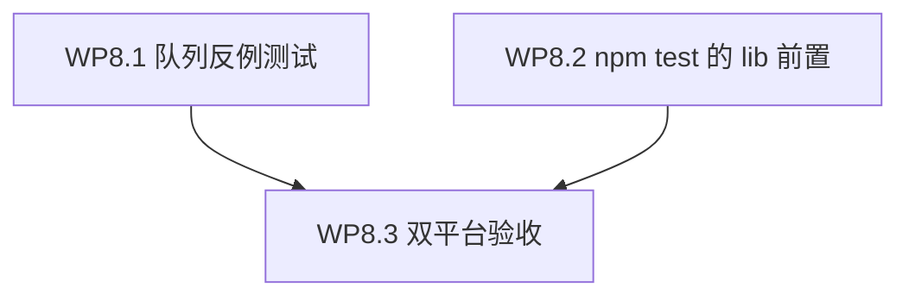

# AI Debate 任务计划（as-built + 剩余工作）

> 版本口径：v0.1.0 的交付已在仓库里；v0.1.1 是发布后的质量修复（单实例、`npm start` 入口、删 CSRF 死代码、清单单一来源）。本文件按**最新工作树**描述状态。
> 配套：[`architecture.md`](./architecture.md)（§13.3 的「仍然开着」清单与 §0.1 的既定输入是本文件的输入）、[`decisions.md`](./decisions.md)、[`differences.md`](./differences.md)
> 本文件回答两个问题：**已经做完了什么**（便于验收对照）、**还差什么、按什么顺序做**。
> 标记：`[done]` 已落地并自测过 ｜ `[blocked]` 阻断发布 ｜ `[release]` 发布前必须 ｜ `[quality]` 可信度项

> **实施偏差说明（发布时补充）**：本文件是设计阶段的方案与任务分解。实际实现中有几处按交付时的判断做了调整，以 `docs/differences.md` 与 `docs/known-issues.md` 为准：
> 1. 任务队列只承载维护类任务（备份/恢复/日志轮转/凭据审计/存储自检），**不承载**分析、生成、发表；`apply()` 未新增第三参数 `hooks`。
> 2. 认证不强制 `x-ai-debate-csrf` 自定义头：setup 只要求「未初始化 + （loopback 或一次性 token）+ 同源（Origin 与 Host 一致）+ `content-type: application/json`」；其余写请求靠「`SameSite=Strict` + 同源 + 强制 JSON」三层。**不要按「需要自定义头」实现，那会让首启流程直接不可用。**
> 3. 监听地址允许自定义（`--host`），默认仍是 `127.0.0.1`；没有「非回环直接拒绝」。
> 4. 前端主视图使用 `DebateCard`（11 个页签），不是把全部区域堆叠的 `DebateSection`。
> 5. 页面外壳是最薄的普通 DOM，没有引入第二个 React 应用，也没有 hash 路由。

---

## 实现红线（不可协商，任何实现都不得违反）

> 这几条不是为了「更好」，是为了挡住**不可逆的错误**。违反其中任何一条，功能再完整也不算完成。

| # | 红线 | 具体要求 | 判定方式 |
|---|------|----------|----------|
| R-1 | **真实发表不得进队列、不得重试** | `publish`（含 `publish-approved`、`verify-publish`）**永不**通过 `JobQueue` 执行；`JobType` 是封闭集合，新增类型必须同时决定它是否可重试 | `jobs.ts` 的 `JobType` 联合类型里没有 publish 类成员；`POST /jobs` 的允许列表（4 类读任务）拒绝其它类型；`runtime.test.ts` 有一条「队列拒绝把发表类动作排进去」 |
| R-2 | **重试与退避只作用于幂等动作** | 只有可安全重放的读/检查类任务进入 `RETRYABLE`；`backup.restore` 明确**不可重试**（崩溃后置 `failed`，因为它不是幂等写） | `RETRYABLE` 集合 + `#recover()` 分支；`runtime.test.ts` 覆盖「restore 崩溃 → failed、其它 → queued」 |
| R-3 | **若将来把 verify 这类写操作排队，`maxAttempts` 必须为 1** | 一次性发表验证的语义是「要么发出去了，要么没发」，重试等于重复发表 | 代码里若出现 `verify*` 类型，其 `maxAttempts` 必须硬编码 1；review 检查项 |
| R-4 | **发表必须人工批准，且批准记录单次有效** | 批准只能由已登录会话经 `POST /approve` 创建；记录绑定 session+candidate+platform+target+account+bodyHash+version，30 分钟过期、消费即失效 | 核心 `security/approvals.ts` + `publisher.ts` 的 `checkApproval/consumeApproval`；验收 A7 |
| R-5 | **未验证的平台能力保持不可用** | 能力矩阵声明 `unavailable` 时，界面上不得出现可点的发表按钮；发布路径必须抛 `capability_not_proven` | 验收 A7；核心 `assertPlatformCapability` |
| R-6 | **凭据只进不出** | 任何接口、日志、备份、诊断都不得回显 Cookie/API Key；`describe()` 只答 `configured` | 验收 A5/A14；`scan-secrets` + `/status` 字段检查 |
| R-7 | **首启不得要求自定义头** | setup 只要求「未初始化 + （loopback 或一次性 token）+ 同源 + `application/json`」；强制自定义头会让初始化直接不可用 | 验收 A2；`entry.cjs` 的 setup 请求只带 `content-type` |
| R-8 | **发布准入不得被削弱** | `scan-secrets` 的豁免只能是**文件级且写明理由**；不得加「跳过 test 目录」这类目录级豁免 | `scripts/scan-secrets.mjs` 的 `ALLOW` 集合；review 检查项 |

---

## 第一部分：已落地（对照验收）

| # | 工作包 | 结果 | 落点 |
|---|--------|------|------|
| WP2 | 核心引擎去 DSH 化 | ✅ 88 个源文件迁入；`config.ts` 只换一行 import（`schemastery` → 本地 `schema.ts`，170 行零依赖构建器）；路由前缀 `/api/ai-debate`；凭据 ref `AI_DEBATE_*`（`LEGACY_*` 仅作显式导入常量）；`store-dir.ts` 改为 `configured → AI_DEBATE_HOME → 平台默认`，旧 DSH 目录只探测；新增 `appServerOf`（让 server 注入 `trustedHosts` 与 `info()`）；`APP_VERSION` 走 SEA 资源 → `import.meta` → `0.0.0-unknown` 三级兜底 | `packages/core/src/{config,schema,settings-routes,secrets,store-dir,diagnostics,host,index}.ts` |
| WP3 | 独立服务端 | ✅ 14 个文件：`app.ts`、`audit.ts`（组合根 + 5 个 job handler + 自动备份 + 自启）、`standalone-host.ts`（适配器）、`http.ts`（认证/路由/静态/运维）、`auth.ts`、`config-store.ts`、`credential-store.ts`、`jobs.ts`、`atomic.ts`、`paths.ts`、`logger.ts`、`assets.ts`、`registry.ts`、`cli.ts` | `packages/server/src/**` |
| WP4 | Web 管理后台 | ✅ `scripts/build-web.mjs` 按字符串偏移切出工厂体 + **7 条**带次数断言改写 + `new Function` 语法校验；`snapshot-store.cjs` 40 行替代 Immer 版；`entry.cjs` 外壳（宿主 shim 让 `apply()` 跑起来注入样式、认证门、顶栏、服务灯、fetch 会话守卫）；`theme.css` 补齐 14 个 `--dsw-alias-*`；产物 `static/assets/app.js` 318 KB + map | `packages/web/**`、`scripts/build-web.mjs` |
| WP5 | 双平台打包 | ✅ `packaging/windows/build.mjs`（收集 `dist/web` 含 `manifest.json` → SEA blob → 复制 node.exe → postject）；`packaging/linux/{build.mjs,install.sh,uninstall.sh,common.sh,ai-debate.service}`（`ProtectSystem=strict`/`ProtectHome`/唯一数据目录 `ReadWritePaths`/`Restart=on-failure`/`SuccessExitStatus=75`/`RestartForceExitStatus=75`；默认保留数据，`--purge --confirm-purge` 才删） | `packaging/**` |
| WP6 | CI 与发布 | ✅ `ci.yml`（secrets-scan → test 矩阵 → 两个打包 job，均 `needs: test`）；`release.yml`（`guard` 拒绝覆盖已存在 Release → `verify` → 两平台构建 → `publish` 生成 `SHA256SUMS` 并复验资产名，无 `--clobber`）；`scan-secrets.mjs`；`assert-no-dsh.mjs`（四查，含「打包二进制在无 DSH 环境下可 `--version`」） | `.github/workflows/**`、`scripts/{scan-secrets,assert-no-dsh}.mjs` |
| 文档 | 用户文档 | ✅ `README.md`、`NOTICE`（上游 AGPL 来源）、`security.md`（保护/不保护都写明）、`install-windows.md`、`install-linux.md`、`migration.md`、`release-notes-v0.1.0.md` | `docs/**` |

**自测状态（逐条实跑，2026-11-19 定时复核）**：`typecheck` ✅｜`build`（core+web）✅｜`bundle` ✅（`dist/ai-debate.cjs` 1127 KB + `dist/web` 6 资源）｜`package:windows` ✅（89.5 MB，`--version` 正常）｜`npm test` ✅（core **113**、server **20**、web **6**、acceptance **25/25**）｜`scan-secrets` ✅（exit 0，**182** 个受版本控制的文件）｜`assert-no-dsh` ✅（106 源文件 / 4 清单 / 91 线路）。**已修并复验**：G3、G4（第二个 `serve` exit 3）、G6、G8-residual、G9、G10、G11（含 fail-closed 对照）、G12、G13、G14、G15、G16、G17。**仍开 1 项**：干净克隆 `npm test` 失败（G18，见 WP8.2）。G16 与 G8-residual 已在本轮修掉。

---

## 第二部分：剩余工作（2 个开发步骤 + 验收）

> 实测基线（本机 Node 22.22.2）：`typecheck` ✅｜`build` ✅｜`bundle` ✅（`dist/ai-debate.cjs` ~1127 KB + `dist/web` 6 资源）｜`package:windows` ✅（89.5 MB，`--version` → `AI Debate 0.1.0 (win32-x64)`）｜`npm test` ✅（core **113** + server **20** + web **6** + acceptance **25/25**）｜`scan-secrets` ✅｜`assert-no-dsh` ✅（108 源文件 / 4 清单 / 91 线路）｜`npm start` → `/healthz` **200** ✅。
> 已修并复验：G3、G4、G6、G9、G9-residual、G10、G11、G12、G13、G14、G15、G17。
> 仍开：**G18（干净克隆 `npm test` 失败，阻断级，见 WP8.2）**。

### WP8.1 `[quality]` 给队列红线补一条运行时反例测试（ADR-018 建议项）

| 项 | 内容 |
|----|------|
| 现状 | `packages/server/test/runtime.test.ts` 里有「任务队列拒绝把发表类动作排进队列」，但它只断言**允许集合是封闭的五项**；TypeScript 的类型联合会在编译期拦住 publish，运行时没有反例 |
| 补 | 一条测试：用 `as never`（或 `as unknown as 'backup.create'`）绕过类型，把 `'publish'` / `'publish.approved'` 传给 `queue.enqueue()`，断言它被拒绝或没有对应的 handler（`#handlers` 里没有该类型时不应执行） |
| 为什么要写 | 类型只在编译期有效；`POST /jobs` 是运行时入口，一旦有人把允许列表改成「取 `JobType` 全集」，类型就帮不上忙了 |
| 验收 | 新测试红→绿：先故意把 publish 塞进队列能跑通（证明测试有效），再断言它不能 |
| 依赖 | 无 |

### WP8.2 `[blocked]` 让 `npm test` 在干净克隆里能跑（测试依赖 `lib` 的隐性前置）

| 项 | 内容 |
|----|------|
| 现象 | 在 `git archive HEAD` 出来的干净树里跑 `npm test`（或单跑 `test:core`）→ 首条测试就 `ERR_MODULE_NOT_FOUND: packages/core/lib/analyzer.js`。因为 `lib/` 被 `.gitignore`，而 8 个 core 测试文件都 import `../lib/*.js` |
| 为什么不能改 import | 实测：把测试改成 `import '../src/config.ts'` 后 → `ERR_MODULE_NOT_FOUND: src/schema.js imported from src/config.ts`。核心源码是 NodeNext 风格（`import './schema.js'`），`--experimental-transform-types` **只剥类型、不改说明符**。要改就得把 88 个文件的相对 import 全改成 `.ts`，代价远大于收益，且与 tsc 产物不一致 |
| 做法（推荐） | 加 `pretest` 钩子：`"pretest": "node scripts/build-core.mjs"`。这样 `npm test` 前自动构建；子命令（`test:core` 等）保持原样，并在 README 写明「单独跑某一套前先 build」 |
| 备选 | 在 `test:core` 脚本里前置 build：`"test:core": "node scripts/build-core.mjs && node --experimental-transform-types --test ..."`。缺点：CI 会重复构建一次（可接受） |
| 验收 | ① 删掉 `packages/core/lib` 后 `npm test` 仍全绿（pretest 自动构建）；② 干净树（`git archive HEAD`）里 `npm install && npm test` 全绿；③ 总时长增加 ≤3s |
| 依赖 | 无 |

### WP8.3 `[release]` 双平台真机验收（收口）

| # | 检查 | 通过标准 |
|---|------|----------|
| A1 | 干净 Windows 双击 EXE | ≤10s 打开首启页；只有一个进程 |
| A2 | 首启安全 | 本地可初始化；非回环需一次性 token；重复 409 |
| A3 | 登录限流 | 连错 8 次 → 429；窗口过后恢复 |
| A4 | 配置往返 | 11 页签无白屏；改 3 字段保存后刷新仍在；`config.json` 无 Cookie/Key |
| A5 | 凭据 | 只显示「已配置」；`credentials.json` 密文；备份 `grep BDUSS` 为空 |
| A6 | 队列 | 建 `backup.create` → 成功；`kill -9` 后重启 → 恢复或按类型 failed |
| A7 | 发表门禁 | 未批准拒绝；批准后走核心门禁；导入会话硬拒 |
| A8 | 备份恢复 | 恢复后配置回滚且 `pre-restore-*` 存在 |
| A9 | 旧数据导入 | dryRun 统计正确；空台账可导入；非空 409 且原文件 sha256 不变 |
| A10 | 卸载 | 二进制消失、数据目录仍在并打印路径；`--purge` 才删 |
| A11 | 无 Node 环境 | 干净机器 `--version` + 浏览器全流程（EXE 与 TGZ 各一次） |
| A12 | 发布 | 两附件 + `SHA256SUMS` 校验通过；重打 tag 被 `guard` 拒 |
| A13 | 远程/反代 | `--host 0.0.0.0` + `AI_DEBATE_TRUSTED_HOSTS` 全功能；未设 env 时 LAN Host 仍 403 |
| A14 | 隐私 | 日志无 Cookie/Key/口令；`audit.jsonl` 有事件且无明文 |
| A15 | 深色模式 | 切系统主题后配置页可读 |
| A16 | 单实例 | 双击两次：第二次只开浏览器；`serve` 第二次 exit 3 |

---

## 第三部分：依赖图

**关键路径**：`WP8.1 / WP8.2 → WP8.3`。两步互相独立，可并行。

## 第四部分：提交约定

- 一个 WP 步骤一次提交；信息 `wp8.<n>: <一句话>`（前五个工作包的历史提交保留原样）。
- 每次提交前本地必跑：`npm run typecheck && npm run build && npm run test:core`（WP8.2 起再加 server/web 测试与 acceptance）。
- 任何「为了让 CI 变绿而放宽断言/删测试」的改动，必须在提交信息里写明理由，并同步 `docs/architecture.md` §13 的缺口状态。
