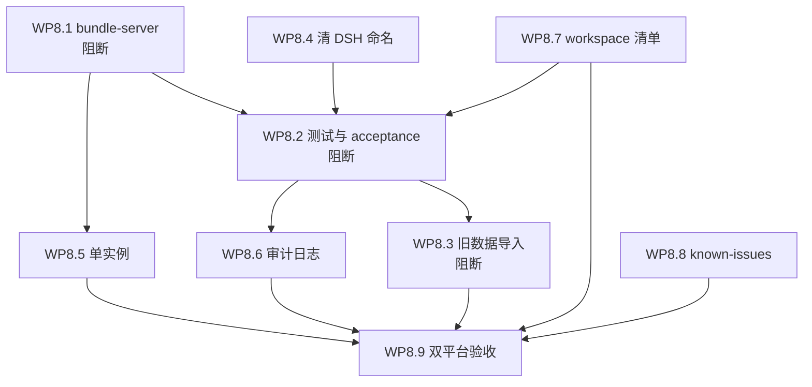

# AI Debate v0.1.0 任务计划（as-built + 剩余工作）

> 配套：[`architecture.md`](./architecture.md)（§13 的 G1–G8 是本文件的输入）、[`decisions.md`](./decisions.md)
> 本文件回答两个问题：**已经做完了什么**（便于验收对照）、**还差什么、按什么顺序做**。
> 标记：`[done]` 已落地并自测过 ｜ `[blocked]` 阻断发布 ｜ `[release]` 发布前必须 ｜ `[quality]` 可信度项

---

## 第一部分：已落地（对照验收）

| # | 工作包 | 结果 | 落点 |
|---|--------|------|------|
| WP2 | 核心引擎去 DSH 化 | ✅ 88 个源文件迁入；`config.ts` 只换一行 import（`schemastery` → 本地 `schema.ts`，170 行零依赖构建器）；路由前缀 `/api/ai-debate`；凭据 ref `AI_DEBATE_*`（`LEGACY_*` 仅作显式导入常量）；`store-dir.ts` 改为 `configured → AI_DEBATE_HOME → 平台默认`，旧 DSH 目录只探测；新增 `appServerOf`（让 server 注入 `trustedHosts` 与 `info()`）；`APP_VERSION` 走 SEA 资源 → `import.meta` → `0.0.0-unknown` 三级兜底 | `packages/core/src/{config,schema,settings-routes,secrets,store-dir,diagnostics,host,index}.ts` |
| WP3 | 独立服务端 | ✅ 13 个文件：`app.ts`（组合根 + 5 个 job handler + 自动备份 + 自启）、`standalone-host.ts`（适配器）、`http.ts`（认证/路由/静态/运维）、`auth.ts`、`config-store.ts`、`credential-store.ts`、`jobs.ts`、`atomic.ts`、`paths.ts`、`logger.ts`、`assets.ts`、`registry.ts`、`cli.ts` | `packages/server/src/**` |
| WP4 | Web 管理后台 | ✅ `scripts/build-web.mjs` 按字符串偏移切出工厂体 + 5 条带次数断言改写 + `new Function` 语法校验；`snapshot-store.cjs` 40 行替代 Immer 版；`entry.cjs` 外壳（宿主 shim 让 `apply()` 跑起来注入样式、认证门、顶栏、服务灯、fetch 会话守卫）；`theme.css` 补齐 14 个 `--dsw-alias-*`；产物 `static/assets/app.js` 318 KB + map | `packages/web/**`、`scripts/build-web.mjs` |
| WP5 | 双平台打包 | ✅ `packaging/windows/build.mjs`（收集 `dist/web` 含 `manifest.json` → SEA blob → 复制 node.exe → postject）；`packaging/linux/{build.mjs,install.sh,uninstall.sh,ai-debate.service}`（`ProtectSystem=strict`/`ProtectHome`/`ReadWritePaths`/`Restart=always`；默认保留数据，`--purge` 才删） | `packaging/**` |
| WP6 | CI 与发布 | ✅ `ci.yml`（secrets-scan → test 矩阵 → 两个打包 job，均 `needs: test`）；`release.yml`（`guard` 拒绝覆盖已存在 Release → `verify` → 两平台构建 → `publish` 生成 `SHA256SUMS` 并复验资产名，无 `--clobber`）；`scan-secrets.mjs`；`assert-no-dsh.mjs`（四查，含「打包二进制在无 DSH 环境下可 `--version`」） | `.github/workflows/**`、`scripts/{scan-secrets,assert-no-dsh}.mjs` |
| 文档 | 用户文档 | ✅ `README.md`、`NOTICE`（上游 AGPL 来源）、`security.md`（保护/不保护都写明）、`install-windows.md`、`install-linux.md`、`migration.md`、`release-notes-v0.1.0.md` | `docs/**` |

**自测状态**：本机 Node 22.22.2；`npm install` 已装好 esbuild 0.25 / typescript 5.7 / postject / jsdom / react 18；`scripts/build-web.mjs` 可产出 `app.js`；`scripts/build-core.mjs` 可产出 `lib`。**未跑通**：完整 `npm run bundle`（脚本缺失，G2）、CI 的 acceptance/server/web 测试（文件缺失，G7）。

---

## 第二部分：剩余工作（按依赖排序）

> 顺序原则：**先把发布链路修绿（G2 → G7），再补用户可感知缺口（G1、G4、G3），最后做质量项（G5/G6/G8）**。
> 每个步骤都能独立提交、独立验证。

### WP8.1 `[blocked]` 让打包链路能跑：`scripts/bundle-server.mjs`

**目标**：`npm run bundle` 产出 `dist/ai-debate.cjs`，`packaging/*/build.mjs` 能接着用。

| 项 | 内容 |
|----|------|
| 新建 | `scripts/bundle-server.mjs` |
| 输入 | `apps/desktop/src/main.ts` |
| esbuild 参数 | `--bundle --platform=node --target=node22 --format=cjs --minify --legal-comments=none --define:process.env.NODE_ENV="production" --outfile=dist/ai-debate.cjs` |
| 必须处理的三个 SEA/CJS 陷阱 | ① `import.meta.url`：core 的 `diagnostics.ts` 用它做版本兜底，CJS 里不可用 → 要么 `--define:import.meta.url='"file:///"'`（不可靠），要么在 core 侧改成「先读 SEA `package.json` 资源、再读 `__AI_DEBATE_VERSION__`、最后 `0.0.0-unknown`」并**删掉 `import.meta` 分支**（推荐，改动 3 行）；② `createRequire(import.meta.url)` 读 `node:sea` → 改成 `createRequire(__filename)`；③ `packages/core` 通过 `@ai-debate/core` 包名引用时，esbuild 需要能解析 workspace 链接（`node_modules/@ai-debate/core` 已存在）或改用相对路径入口 |
| 验收 | ① `node dist/ai-debate.cjs --version` 打印 `0.1.0`；② `node dist/ai-debate.cjs serve --port 0` 起得来，`/healthz` 200；③ 打包出的 EXE `--version`/`--help` 正常（CI 已有这两条断言）；④ `dist/ai-debate.cjs` 里 `grep -c "dsh-ai-debate"` 只剩注释（配合 WP8.4） |
| 依赖 | 无 |

### WP8.2 `[blocked]` 补测试，让 CI 的 test job 真的能过

**目标**：`ci.yml` 里引用的四个路径都存在且有意义。

| 项 | 内容 |
|----|------|
| 新建 | `test/acceptance/standalone.ts`、`packages/server/test/{atomic,credentials,config,acth,jobs,http}.test.ts`（至少 5 个文件） |
| `test/acceptance/standalone.ts` 断言 | ① 临时 dataDir + 端口 0 起真实服务；② `/healthz` 200 且 `ok:true`；③ 未初始化时 `/api/ai-debate/settings` → 401；`/auth/setup` 无 body → 400；带正确 body → 200 + Set-Cookie；④ 用 cookie 访问 `/settings` → 200 且 `values` 里**没有** `tiebaCookie`/`llmApiKey`；⑤ `engine.tools === 9`、`engine.routes` 含 7 条核心路径；⑥ `POST /secrets` 写一个假值 → `describe` 报 configured；`credentials.json` 里 `grep` 不到该值；⑦ `/system/logs` 至少 1 行；⑧ 备份 → 改配置 → 恢复 → 配置回滚且 `pre-restore-*` 存在；⑨ 关闭服务后 `run/server.json` 已删 |
| 服务端单测 | `atomic`：中断后旧文件完好、`.bak` 存在、损坏 JSON 被隔离改名；`credential-store`：密文循环 + 篡改 1 字节即抛 + 未知 ref 拒绝；`auth`：错口令 8 次 → 429、`Retry-After` 有值、初始化后 setup 409；`jobs`：去重、退避、达到 maxAttempts 置 failed、`running` 崩溃 → analyze 类回 queued / restore 置 failed、队列满 200 抛 `queue_full`；`config-store`：hash 冲突抛错、`replaceAll` 生效 |
| web 测试 | `packages/web/test/render.test.mjs` 已存在；补一条「页面渲染后 `dsd-card` 存在且 11 个 tab 按钮数量为 11」 |
| 验收 | `npm run test:core`、`node --test packages/server/test/*.test.ts`、`node --test packages/web/test/*.test.mjs`、`node --experimental-transform-types test/acceptance/standalone.ts` 四命令本地全绿 |
| 依赖 | WP8.1（acceptance 需要 bundle 或至少能 `serve`；也可直接用 `tsx` 起 server，二者取一，但 CI 用的是 bundle 后的路径） |

### WP8.3 `[blocked]` 旧数据导入（文档已承诺）

| 项 | 内容 |
|----|------|
| 修改 | `packages/server/src/app.ts`（新增 job `legacy.import` 或直接同步动作）；`packages/server/src/http.ts`（`/system/action` 增 `import-legacy`，支持 `dryRun`） |
| 行为 | ① `dryRun:true` → 只读 `<legacy>/state.json`，返回 `{sessions, candidates, ledger, approvals, bytes, mtime}`，不写任何文件；② `dryRun:false` 且新 `state.json` 不存在或为空台账（`sessions.length===0 && ledger.length===0`）→ 先写 `backups/pre-import-<ts>/state.json`（若已有）→ 复制 → 返回 `{ok, imported}`；③ 新台账非空 → 409 + 明确文案「不会合并两份台账：那会让『是否已发表』失去唯一答案」 |
| 凭据 | **不导入**。`LEGACY_*` ref 常量只用于「告诉用户旧值存在过」，不读 DSH 的凭据库；文案写明需重录 |
| 验收 | ① 造一个假 `~/.dsh/ai-debate/state.json`（3 个会话）→ dryRun 报 3；② 新台账为空 → 导入后 `state.json` 存在且 3 个会话可读；③ 新台账非空 → 409 且原 `state.json` sha256 不变；④ `pre-import-*` 目录存在 |
| 依赖 | WP8.2（要能测） |

### WP8.4 `[release]` 清掉 core 的 DSH 命名残留（G3）

| 项 | 内容 |
|----|------|
| 修改 | `packages/core/src/tools.ts`（`loggerOf(ctx,'dsh-ai-debate')` 两处 → `'ai-debate'`；四处「设置 → 插件 → dsh-ai-debate → 配置」→「管理后台 → 配置」）；`packages/core/src/store.ts`（`defaultStoreDir()` 返回 `~/.dsh/ai-debate`，目前无人调用 → 删除导出，或改为委托 `store-dir.platformDefaultStoreDir`） |
| 不改 | `store-dir.ts` 的 `legacyDshStoreDir`（它是文件系统事实，是导入功能的输入）；`secrets.ts` 的 `LEGACY_*` 常量（显式导入需要） |
| 验收 | ① `grep -rn "dsh" packages/core/src` 只剩 `store-dir.ts`（legacy 探测）、`secrets.ts`（LEGACY 常量）、注释里的来源说明；② `assert-no-dsh.mjs` 收紧：把允许清单从「全部源码」缩到明确文件，其余出现即失败；③ 页面/工具返回值里不再出现「插件 →」字样 |
| 依赖 | 无（可与 WP8.1 并行） |

### WP8.5 `[release]` 单实例约束（G4）

| 项 | 内容 |
|----|------|
| 修改 | `packages/server/src/app.ts`、`packages/server/src/paths.ts`（新增 `instanceFile = run/instance.lock`）、`packages/server/src/cli.ts`（`serve` 前探测） |
| 行为 | ① 监听成功后写 `run/instance.lock = {pid, host, port, token, startedAt, dataDir}`（0600）；② 启动时若 lock 存在且 pid 存活且 `/healthz` 可达 → **不换端口**，打印「已有实例在 http://host:port/」并 `exit 3`；③ pid 不存活（崩溃残留）→ 覆盖写；④ 关闭时删 lock |
| 判定 | pid 存活用 `process.kill(pid, 0)`（Windows 上 EPERM 也算存活）；不做强制 kill |
| 验收 | ① 连开两次 `serve` → 第二次 exit 3 且打印已有实例端口；② `kill -9` 第一个后 `serve` 能正常启动并覆盖 lock；③ 正常 `stop` 后 lock 消失 |
| 依赖 | WP8.1（CLI 要能启动服务） |

### WP8.6 `[quality]` 审计日志（G6）

| 项 | 内容 |
|----|------|
| 修改 | `packages/server/src/logger.ts`（新增 `audit(event, detail)`）；调用点：`auth.ts`（login.ok / login.fail / login.throttled / admin.created / password.changed / logout）、`http.ts`（setup / import-legacy / backup / restore / autostart / shutdown / restart） |
| 格式 | 单行 JSONL：`{"at":"ISO","event":"login.fail","ip":"127.0.0.1","user":"owner","detail":{...}}`；**永不写明文口令/Cookie/Key**（复用 `redact()`） |
| 验收 | ① 登一次成功 + 登一次失败 → `logs/audit.jsonl` 各有 1 行；② 行内 `grep -i password` 只出现字段名不出现值；③ 写盘失败不影响请求（降级为 warn） |
| 依赖 | WP8.2 |

### WP8.7 `[quality]` 补 workspace 清单（G5）

| 项 | 内容 |
|----|------|
| 新建 | `packages/web/package.json`（`@ai-debate/web`，private，`exports: {}`，无 scripts 或只放 `build` 注释）、`packages/server/package.json`（已存在则加 `scripts.typecheck`） |
| 目的 | 让 `workspaces: ["packages/*"]` 名副其实；`assert-no-dsh` 读清单时不再跳过 |
| 验收 | ① `npm install` 后 lock 里出现 `packages/web` 与 `packages/server`；② `npm ci` 仍能过；③ `assert-no-dsh` 检查到三个清单且无 `@deepseek-ai` |
| 依赖 | 无 |

### WP8.8 `[quality]` 补 `docs/known-issues.md`（G8）

| 项 | 内容 |
|----|------|
| 新建 | `docs/known-issues.md` |
| 至少覆盖 | ARM64 未构建；无内置 TLS（用反代）；Windows 未签名（SmartScreen）；多用户/角色未做；双向认证未做；微博需外部 `weibo-cli`；旧数据导入仅覆盖空台账；单实例靠 lock 而非系统级互斥；限流计数在内存；审计日志未签名；备份不含凭据（换机需重录）；系统钥匙串未接（同用户进程可解密凭据） |
| 验收 | `release-notes-v0.1.0.md` 的链接可达；每条都写了影响 + 缓解 |
| 依赖 | 无 |

### WP8.9 `[release]` 双平台真机验收

| # | 检查 | 通过标准 |
|---|------|----------|
| A1 | 干净 Windows 双击 EXE | ≤10s 浏览器打首次初始化页；任务管理器只有一个进程（launcher 已退出） |
| A2 | 首启安全 | 非回环监听时（`--host 0.0.0.0`）未带 token 的 setup → 403；带日志里的 token → 200；再来 → 409 |
| A3 | 登录限流 | 连错 8 次 → 429 且有 `Retry-After`；正确口令仍被拒直到窗口过去 |
| A4 | 配置往返 | 11 页签逐个打开无白屏；改 3 个字段保存 → 刷新仍在；`config.json` 里无 Cookie/Key |
| A5 | 凭据 | 保存 Cookie → 页面只显示「已配置」；`credentials.json` 打开是密文；备份目录里 `grep BDUSS` 为空 |
| A6 | 队列 | 手动 `/jobs` 建 `backup.create` → 列表出现 → 成功；`kill -9` 后重启 → 恢复为 queued 或按类型 failed（restore） |
| A7 | 发表门禁 | 未批准 → 拒绝；批准后 → 走核心门禁（无能力时 `capability_not_proven`）；导入会话 → 硬拒 |
| A8 | 备份恢复 | 备份 → 改配置 → 恢复 → 重启后是新配置；`pre-restore-*` 存在 |
| A9 | 旧数据导入 | 见 WP8.3 的四条断言（真机跑一次） |
| A10 | 卸载 | `uninstall.sh` 后二进制消失、数据目录仍在并打印路径；`--purge` 才删 |
| A11 | 无 Node 环境 | 干净机器/容器跑 `--version`、`serve`、浏览器全流程 |
| A12 | 发布 | Release 两附件 + `SHA256SUMS.txt` 校验通过；重打同 tag 被 `guard` 拒绝 |
| A13 | 隐私 | 日志无 Cookie/Key/口令；`/system/status` 无凭据字段 |
| A14 | 深色模式 | 切系统主题后配置页文字与状态色可读 |

---

## 第三部分：依赖图

**关键路径**：`WP8.1 → WP8.2 → WP8.3 → WP8.9`（打包 → 测试 → 迁移 → 验收）。
`WP8.4 / WP8.7 / WP8.8` 可并行；`WP8.5 / WP8.6` 在 WP8.1 之后可并行。

---

## 第四部分：提交约定

- 一个 WP 步骤一次提交；信息 `wp8.<n>: <一句话>`（前五个工作包的历史提交保留原样）。
- 每次提交前本地必跑：`npm run typecheck && npm run build && npm run test:core`（WP8.2 起再加 server/web 测试与 acceptance）。
- 任何「为了让 CI 变绿而放宽断言/删测试」的改动，必须在提交信息里写明理由，并同步 `docs/architecture.md` §13 的缺口状态。
