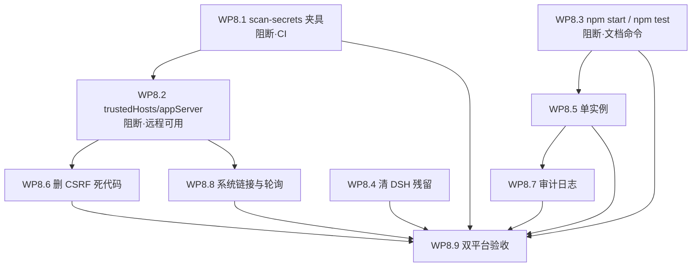

# AI Debate v0.1.0 任务计划（as-built + 剩余工作）

> 配套：[`architecture.md`](./architecture.md)（§13.3 的 G3/G4/G6/G9–G14 是本文件的输入）、[`decisions.md`](./decisions.md)、[`differences.md`](./differences.md)
> 本文件回答两个问题：**已经做完了什么**（便于验收对照）、**还差什么、按什么顺序做**。
> 标记：`[done]` 已落地并自测过 ｜ `[blocked]` 阻断发布 ｜ `[release]` 发布前必须 ｜ `[quality]` 可信度项

> **实施偏差说明（发布时补充）**：本文件是设计阶段的方案与任务分解。实际实现中有几处按交付时的判断做了调整，以 `docs/differences.md` 与 `docs/known-issues.md` 为准：
> 1. 任务队列只承载维护类任务（备份/恢复/日志轮转/凭据审计/存储自检），**不承载**分析、生成、发表；`apply()` 未新增第三参数 `hooks`。
> 2. 认证不强制 `x-ai-debate-csrf` 自定义头，改为「同源 + `application/json` + `SameSite=Strict`」。
> 3. 监听地址允许自定义（`--host`），默认仍是 `127.0.0.1`；没有「非回环直接拒绝」。
> 4. 前端主视图使用 `DebateCard`（11 个页签），不是把全部区域堆叠的 `DebateSection`。
> 5. 页面外壳是最薄的普通 DOM，没有引入第二个 React 应用，也没有 hash 路由。

---

## 第一部分：已落地（对照验收）

| # | 工作包 | 结果 | 落点 |
|---|--------|------|------|
| WP2 | 核心引擎去 DSH 化 | ✅ 88 个源文件迁入；`config.ts` 只换一行 import（`schemastery` → 本地 `schema.ts`，170 行零依赖构建器）；路由前缀 `/api/ai-debate`；凭据 ref `AI_DEBATE_*`（`LEGACY_*` 仅作显式导入常量）；`store-dir.ts` 改为 `configured → AI_DEBATE_HOME → 平台默认`，旧 DSH 目录只探测；新增 `appServerOf`（让 server 注入 `trustedHosts` 与 `info()`）；`APP_VERSION` 走 SEA 资源 → `import.meta` → `0.0.0-unknown` 三级兜底 | `packages/core/src/{config,schema,settings-routes,secrets,store-dir,diagnostics,host,index}.ts` |
| WP3 | 独立服务端 | ✅ 13 个文件：`app.ts`（组合根 + 5 个 job handler + 自动备份 + 自启）、`standalone-host.ts`（适配器）、`http.ts`（认证/路由/静态/运维）、`auth.ts`、`config-store.ts`、`credential-store.ts`、`jobs.ts`、`atomic.ts`、`paths.ts`、`logger.ts`、`assets.ts`、`registry.ts`、`cli.ts` | `packages/server/src/**` |
| WP4 | Web 管理后台 | ✅ `scripts/build-web.mjs` 按字符串偏移切出工厂体 + **7 条**带次数断言改写 + `new Function` 语法校验；`snapshot-store.cjs` 40 行替代 Immer 版；`entry.cjs` 外壳（宿主 shim 让 `apply()` 跑起来注入样式、认证门、顶栏、服务灯、fetch 会话守卫）；`theme.css` 补齐 14 个 `--dsw-alias-*`；产物 `static/assets/app.js` 318 KB + map | `packages/web/**`、`scripts/build-web.mjs` |
| WP5 | 双平台打包 | ✅ `packaging/windows/build.mjs`（收集 `dist/web` 含 `manifest.json` → SEA blob → 复制 node.exe → postject）；`packaging/linux/{build.mjs,install.sh,uninstall.sh,ai-debate.service}`（`ProtectSystem=strict`/`ProtectHome`/`ReadWritePaths`/`Restart=always`；默认保留数据，`--purge` 才删） | `packaging/**` |
| WP6 | CI 与发布 | ✅ `ci.yml`（secrets-scan → test 矩阵 → 两个打包 job，均 `needs: test`）；`release.yml`（`guard` 拒绝覆盖已存在 Release → `verify` → 两平台构建 → `publish` 生成 `SHA256SUMS` 并复验资产名，无 `--clobber`）；`scan-secrets.mjs`；`assert-no-dsh.mjs`（四查，含「打包二进制在无 DSH 环境下可 `--version`」） | `.github/workflows/**`、`scripts/{scan-secrets,assert-no-dsh}.mjs` |
| 文档 | 用户文档 | ✅ `README.md`、`NOTICE`（上游 AGPL 来源）、`security.md`（保护/不保护都写明）、`install-windows.md`、`install-linux.md`、`migration.md`、`release-notes-v0.1.0.md` | `docs/**` |

**自测状态（逐条实跑，2026-11-19）**：`typecheck` ✅｜`build`（core+web）✅｜`bundle` ✅（`dist/ai-debate.cjs` 1124 KB + `dist/web` 5 资源）｜`package:windows` ✅（89.5 MB，`--version` 正常）｜core 测试 111/111 ✅｜server 14/14 ✅｜web 6/6 ✅｜acceptance **25/25** ✅｜`assert-no-dsh` ✅。**未通过**：`scan-secrets` ✖（exit 1，命中测试夹具，G10）｜`npm test` 跑 0 个测试（G12）｜`npm start` MODULE_NOT_FOUND（G9）｜`--host 0.0.0.0` 下核心路由 403（G11）。

---

## 第二部分：剩余工作（按依赖排序，逐条实测）

> 实测基线（本机 Node 22.22.2，2026-11-19）：`npm run typecheck` ✅ ｜ `npm run build` ✅ ｜ `npm run bundle` ✅（`dist/ai-debate.cjs` 1124 KB）｜ `npm run package:windows` ✅（`dist/AI-Debate-windows-x64.exe` 89.5 MB，`--version` 正常）｜ `test:core` 111/111 ✅ ｜ server 14/14 ✅ ｜ web 6/6 ✅ ｜ `test/acceptance/standalone.ts` 25/25 ✅ ｜ `assert-no-dsh` ✅ ｜ **`scan-secrets` ✖（exit 1）** ｜ **`npm test` 跑 0 个测试（exit 0）** ｜ **`npm start` MODULE_NOT_FOUND** ｜ **`--host 0.0.0.0` 下核心路由 403**。

### WP8.1 `[blocked]` 修掉让 CI 永远红的凭据扫描（G10）

**为什么第一优先**：`ci.yml` 的 `secrets-scan` 是第一个 job，它红了整个 CI 就红，`release.yml` 的 `verify` 也会红 —— **发布链路彻底不可用**。

| 项 | 内容 |
|----|------|
| 现象 | `node scripts/scan-secrets.mjs` → exit 1，命中 `packages/server/test/runtime.test.ts` 的第 68 行（`sk-` 前缀假 key）与第 252 行（`BDUSS=` 形态假 cookie） |
| 性质 | 这两处是**故意**的测试夹具：一处验证「密文不落盘」，一处验证「日志打码」。扫描器没错，夹具写法错了 —— 真实形态被静态写进文件 |
| 推荐改法 | 把夹具改成**运行时拼接**，让源码里不出现完整形态：`const FAKE_KEY = 'sk-' + 'super-secret-value-123456'`、`const FAKE_COOKIE = 'BDUSS=' + 'abcdefghijklmnop'`（扫描器的正则会匹配 `sk-[A-Za-z0-9_-]{24,}` 与 `BDUSS(?:...)={16,}`，拼接后单行不满足长度） |
| 不改扫描器 | **不要在 `scan-secrets.mjs` 里加「测试目录跳过」**：那等于给发布准入开洞，真实凭据一旦被写进测试文件就再也拦不住 |
| 验收 | `node scripts/scan-secrets.mjs` exit 0；且把一条真形态字符串手工塞进任意源文件 → 仍 exit 1（证明没被削弱） |
| 依赖 | 无 |

### WP8.2 `[blocked]` 让 `--host 0.0.0.0` 与反代真的能用（G11）

**为什么第二优先**：`security.md` §6、`install-linux.md` 的 `--host 0.0.0.0` 与「用反代远程访问」是**已经写进用户文档**的能力，实测却 403。

| 项 | 内容 |
|----|------|
| 实测 | `dist/ai-debate.cjs serve --host 0.0.0.0` + 原生 `http` 构造 `Host: 192.168.1.20:<port>` 或 `Host: debate.example.com` → `/api/ai-debate/settings` **403 `forbidden: origin`**；同路径 `Host: 127.0.0.1:<port>` → 401（围栏放行，只是无会话） |
| 根因 | `standalone-host.ts` 的 `services` 里没有 `appServer`，核心的 `appServerOf(ctx)` 拿不到 `trustedHosts`，回落到 `DEFAULT_TRUSTED_HOSTS`（仅 4 个 loopback 名） |
| 改法 | ① `StandaloneHostOptions` 增加 `trustedHosts: readonly string[]` 与 `listen: { host, port, startedAt }`；② `services` 增加 `appServer: { trustedHosts, info() }`（`info()` 返回 `{listen, port, dataDir, version, startedAt, pid}`，与核心 `AppServerService` 逐字段一致 —— 顺带补齐设置页缺失的「进程事实」块）；③ 新增 `env`：`AI_DEBATE_TRUSTED_HOSTS`（逗号分隔）供反代场景显式追加；④ 推导规则：恒含 `127.0.0.1/localhost/[::1]/::1`；`--host` 是具体地址时加该地址；`0.0.0.0` 不加任何内网 IP（**不猜测**，必须由 env 显式给） |
| 安全约束 | `trustedHosts` **永不从 `Host` 头推断**（那会让 DNS rebinding 防线失效）；反代必须原样转发 `Host`/`Origin`，文档已写明 |
| 验收 | ① `--host 0.0.0.0` + `AI_DEBATE_TRUSTED_HOSTS=192.168.1.20` → `Host: 192.168.1.20:<port>` 的 `/settings` 返回 401（放行）；② 不设 env 时同请求仍 403（默认收口）；③ `Host: debate.example.com` 且未在 env 里 → 403；④ `test/acceptance/standalone.ts` 增加这两条断言 |
| 依赖 | WP8.1（CI 要先能绿，否则改动无法验证） |

### WP8.3 `[blocked]` 修 `npm start` 与根 `npm test`（G9、G12）

| 项 | 内容 |
|----|------|
| G9 | `package.json` 的 `start` 指向不存在的 `packages/server/src/main.ts` → 实跑 `MODULE_NOT_FOUND`。**推荐**：新建 `packages/server/src/main.ts`，内容与 `apps/desktop/src/main.ts` 同构（`runCli(process.argv.slice(2)).catch(...)`），这样「服务端入口」与「桌面入口」是两个显式文件而不是隐式路径 |
| G12 | 根 `test` 是 `"test/**/*.test.ts"`，而 `test/` 下只有 `acceptance/standalone.ts`（不匹配）→ 实测 `1..0`、exit 0。改成串行四条：`npm run test:core && npm run test:server && npm run test:web && npm run acceptance` |
| 验收 | ① `npm start` 打印监听地址并可 `curl /healthz`；② `npm test` 输出 ≥131 个测试且 exit 0；③ 故意让 `test:server` 里一条断言失败 → `npm test` exit 非 0 |
| 依赖 | 无 |

### WP8.4 `[release]` 清 core 命名残留（G3，范围已缩小）

| 项 | 内容 |
|----|------|
| 改 | `packages/core/src/store.ts`：删除 `defaultStoreDir()`（实测**全仓库无调用方**，且它返回 `~/.dsh/ai-debate`）；`packages/core/src/tools.ts`：2 处 `loggerOf(ctx,'dsh-ai-debate')` → `'ai-debate'`，4 处「设置 → 插件 → dsh-ai-debate → 配置」→「管理后台 → 配置」 |
| 不改 | `store-dir.ts` 的 `legacyDshStoreDir`（导入功能需要它，是文件系统事实）；`secrets.ts` 的 `LEGACY_*`（显式导入需要） |
| 验收 | `assert-no-dsh.mjs` 白名单收紧到「仅 `store-dir.ts`、`secrets.ts`、注释」；`grep -rn "dsh-ai-debate" packages/core/src` 只剩上述两文件与注释 |
| 依赖 | 无 |

### WP8.5 `[release]` 单实例约束（G4）

| 项 | 内容 |
|----|------|
| 改 | `paths.ts` 加 `instanceFile = run/instance.lock`；`app.ts` 监听成功后写 `{pid, host, port, token, startedAt}`（0600），关闭时删；`cli.ts` 的 `serve` 启动前探测：活实例（pid 存活 + `/healthz` 可达）→ 打印地址并 `exit 3`，不换端口 |
| 判定 | `process.kill(pid, 0)`（Windows 上 EPERM 也算存活）；不做强制 kill；死 pid 直接覆盖 |
| 验收 | ① 连开两次 `serve` → 第二次 exit 3 且打印已有端口；② `kill -9` 后能正常启动；③ `stop` 后 lock 消失 |
| 依赖 | WP8.3（`serve` 要能跑） |

### WP8.6 `[quality]` 让「CSRF 头」不再是死代码（G13）

| 项 | 内容 |
|----|------|
| 选择 | **v0.1.0 选删除**：`entry.cjs` 的 `CSRF_HEADER`/`CSRF_SETUP`/`csrfToken`/`guardedFetch` 注入分支一并删掉，把注释改成「CSRF 由 Strict cookie + Origin/Host + 强制 JSON 覆盖」；`docs/security.md` §2 的 CSRF 行同步 |
| 为什么不实现 | 实现要对 `/auth/state` 增加会话绑定 token、在 `http.ts` 与核心的 `authorize` 之外再加一层校验，而它保护的场景（跨站写）已被三层覆盖 —— 加一层只会多一处要维护、多一处可能误判 |
| 验收 | 页面登录 → 保存配置/保存凭据/建备份任务全部正常（说明删掉后没有功能回退）；`grep -rn "x-ai-debate-csrf" packages/web/src` 为 0 |
| 依赖 | WP8.2（反代场景要先能通，否则验证不了「远程也正常」） |

### WP8.7 `[quality]` 审计日志（G6）

| 项 | 内容 |
|----|------|
| 改 | `logger.ts` 加 `audit(event, detail)`（单行 JSONL，复用 `redact()`，写失败只 warn）；`auth.ts`（login.ok / login.fail / login.throttled / admin.created / password.changed / logout / logoutAll）；`http.ts`（setup / backup / restore / import-legacy / autostart / shutdown / restart） |
| 验收 | ① 一次成功 + 一次失败登录 → `logs/audit.jsonl` 各 1 行；② 行内 `grep -i password` 只出现字段名；③ 把 `audit.jsonl` 设为只读 → 请求仍成功（只有 warn） |
| 依赖 | WP8.5 |

### WP8.8 `[quality]` 顶栏「系统」链接改到状态页（G14）

| 项 | 内容 |
|----|------|
| 改 | `entry.cjs`：系统链接 `href='/system'`（服务端已渲染 HTML 状态页，含队列/日志/旧数据/进程事实）；服务灯轮询改指向 `/api/ai-debate/system/status`（轻量），避免每 30s 跑一遍平台诊断 |
| 验收 | ① 点「系统」看到状态页而不是 JSON；② 服务灯在服务停止后 30s 内变红；③ 轮询不再出现在核心 `/status` 的日志里 |
| 依赖 | WP8.2（`/system/status` 需要 `appServer.info()` 才有内容） |

### WP8.9 `[release]` 双平台真机验收

| # | 检查 | 通过标准 | 与本文件的对应 |
|---|------|----------|----------------|
| A1 | 干净 Windows 双击 EXE | ≤10s 打开首启页；任务管理器只有一个进程 | WP8.3 |
| A2 | 首启安全 | 未初始化 + loopback → 可初始化；非回环 → 无 token 403、带 token 200、再来 409 | — |
| A3 | 登录限流 | 连错 8 次 → 429 + `Retry-After`；窗口过后恢复 | — |
| A4 | 配置往返 | 11 页签无白屏；改 3 字段保存 → 刷新仍在；`config.json` 无 Cookie/Key | — |
| A5 | 凭据 | 保存后页面只显示「已配置」；`credentials.json` 密文；备份里 `grep BDUSS` 为空 | WP8.1 |
| A6 | 队列 | 建 `backup.create` → 成功；`kill -9` 后重启 → 恢复或按类型 failed | — |
| A7 | 发表门禁 | 未批准拒绝；批准后走核心门禁；导入会话硬拒 | — |
| A8 | 备份恢复 | 恢复后配置回滚且 `pre-restore-*` 存在 | — |
| A9 | 旧数据导入 | dryRun 统计正确；空台账可导入；非空 409 且原文件 sha256 不变 | — |
| A10 | 卸载 | 二进制消失、数据目录仍在并打印路径；`--purge` 才删 | — |
| A11 | 无 Node 环境 | 干净机器跑 `--version` + 全流程 | WP8.3 |
| A12 | 发布 | 两附件 + `SHA256SUMS` 校验通过；重打 tag 被拒 | WP8.1 |
| A13 | 远程/反代 | `--host 0.0.0.0` + `AI_DEBATE_TRUSTED_HOSTS` 下页面全功能可用；未设 env 时仍 403 | **WP8.2** |
| A14 | 隐私 | 日志无 Cookie/Key/口令；`audit.jsonl` 有事件且不含明文 | WP8.7 |
| A15 | 深色模式 | 切系统主题后配置页文字与状态色可读 | — |
| A16 | 单实例 | 双击两次只开一个服务、第二次只开浏览器 | WP8.5 |

---

## 第三部分：依赖图

**关键路径**：`WP8.1 → WP8.2 → WP8.9`（CI 能绿 → 远程能用 → 验收）。
可并行：`WP8.3`、`WP8.4`（与 WP8.1/8.2 无耦合）。

## 第四部分：提交约定

- 一个 WP 步骤一次提交；信息 `wp8.<n>: <一句话>`（前五个工作包的历史提交保留原样）。
- 每次提交前本地必跑：`npm run typecheck && npm run build && npm run test:core`（WP8.2 起再加 server/web 测试与 acceptance）。
- 任何「为了让 CI 变绿而放宽断言/删测试」的改动，必须在提交信息里写明理由，并同步 `docs/architecture.md` §13 的缺口状态。
