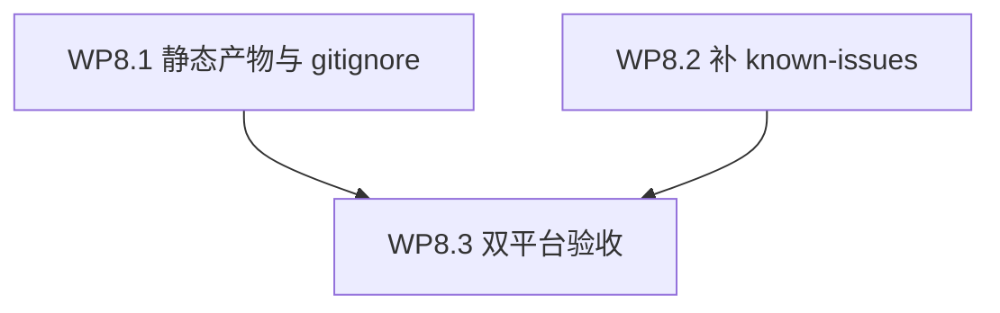

# AI Debate 任务计划（as-built + 剩余工作）

> 版本口径：v0.1.0 的交付已在仓库里；v0.1.1 是发布后的质量修复（单实例、`npm start` 入口、删 CSRF 死代码、清单单一来源）。本文件按**最新工作树**描述状态。
> 配套：[`architecture.md`](./architecture.md)（§13.3 的「仍然开着」2 项是本文件的输入）、[`decisions.md`](./decisions.md)、[`differences.md`](./differences.md)
> 本文件回答两个问题：**已经做完了什么**（便于验收对照）、**还差什么、按什么顺序做**。
> 标记：`[done]` 已落地并自测过 ｜ `[blocked]` 阻断发布 ｜ `[release]` 发布前必须 ｜ `[quality]` 可信度项

> **实施偏差说明（发布时补充）**：本文件是设计阶段的方案与任务分解。实际实现中有几处按交付时的判断做了调整，以 `docs/differences.md` 与 `docs/known-issues.md` 为准：
> 1. 任务队列只承载维护类任务（备份/恢复/日志轮转/凭据审计/存储自检），**不承载**分析、生成、发表；`apply()` 未新增第三参数 `hooks`。
> 2. 认证不强制 `x-ai-debate-csrf` 自定义头，改为「同源 + `application/json` + `SameSite=Strict`」。
> 3. 监听地址允许自定义（`--host`），默认仍是 `127.0.0.1`；没有「非回环直接拒绝」。
> 4. 前端主视图使用 `DebateCard`（11 个页签），不是把全部区域堆叠的 `DebateSection`。
> 5. 页面外壳是最薄的普通 DOM，没有引入第二个 React 应用，也没有 hash 路由。

---

## 第一部分：已落地（对照验收）

| # | 工作包 | 结果 | 落点 |
|---|--------|------|------|
| WP2 | 核心引擎去 DSH 化 | ✅ 88 个源文件迁入；`config.ts` 只换一行 import（`schemastery` → 本地 `schema.ts`，170 行零依赖构建器）；路由前缀 `/api/ai-debate`；凭据 ref `AI_DEBATE_*`（`LEGACY_*` 仅作显式导入常量）；`store-dir.ts` 改为 `configured → AI_DEBATE_HOME → 平台默认`，旧 DSH 目录只探测；新增 `appServerOf`（让 server 注入 `trustedHosts` 与 `info()`）；`APP_VERSION` 走 SEA 资源 → `import.meta` → `0.0.0-unknown` 三级兜底 | `packages/core/src/{config,schema,settings-routes,secrets,store-dir,diagnostics,host,index}.ts` |
| WP3 | 独立服务端 | ✅ 13 个文件：`app.ts`（组合根 + 5 个 job handler + 自动备份 + 自启）、`standalone-host.ts`（适配器）、`http.ts`（认证/路由/静态/运维）、`auth.ts`、`config-store.ts`、`credential-store.ts`、`jobs.ts`、`atomic.ts`、`paths.ts`、`logger.ts`、`assets.ts`、`registry.ts`、`cli.ts` | `packages/server/src/**` |
| WP4 | Web 管理后台 | ✅ `scripts/build-web.mjs` 按字符串偏移切出工厂体 + **7 条**带次数断言改写 + `new Function` 语法校验；`snapshot-store.cjs` 40 行替代 Immer 版；`entry.cjs` 外壳（宿主 shim 让 `apply()` 跑起来注入样式、认证门、顶栏、服务灯、fetch 会话守卫）；`theme.css` 补齐 14 个 `--dsw-alias-*`；产物 `static/assets/app.js` 318 KB + map | `packages/web/**`、`scripts/build-web.mjs` |
| WP5 | 双平台打包 | ✅ `packaging/windows/build.mjs`（收集 `dist/web` 含 `manifest.json` → SEA blob → 复制 node.exe → postject）；`packaging/linux/{build.mjs,install.sh,uninstall.sh,ai-debate.service}`（`ProtectSystem=strict`/`ProtectHome`/`ReadWritePaths`/`Restart=always`；默认保留数据，`--purge` 才删） | `packaging/**` |
| WP6 | CI 与发布 | ✅ `ci.yml`（secrets-scan → test 矩阵 → 两个打包 job，均 `needs: test`）；`release.yml`（`guard` 拒绝覆盖已存在 Release → `verify` → 两平台构建 → `publish` 生成 `SHA256SUMS` 并复验资产名，无 `--clobber`）；`scan-secrets.mjs`；`assert-no-dsh.mjs`（四查，含「打包二进制在无 DSH 环境下可 `--version`」） | `.github/workflows/**`、`scripts/{scan-secrets,assert-no-dsh}.mjs` |
| 文档 | 用户文档 | ✅ `README.md`、`NOTICE`（上游 AGPL 来源）、`security.md`（保护/不保护都写明）、`install-windows.md`、`install-linux.md`、`migration.md`、`release-notes-v0.1.0.md` | `docs/**` |

**自测状态（逐条实跑，2026-11-19 定时复核）**：`typecheck` ✅｜`build`（core+web）✅｜`bundle` ✅（`dist/ai-debate.cjs` 1127 KB + `dist/web` 6 资源）｜`package:windows` ✅（89.5 MB，`--version` 正常）｜`npm test` ✅（core **113**、server **20**、web **6**、acceptance **25/25**）｜`scan-secrets` ✅（exit 0，**182** 个受版本控制的文件）｜`assert-no-dsh` ✅（106 源文件 / 4 清单 / 91 线路）。**已修并复验**：G3、G4（第二个 `serve` exit 3）、G6、G9（入口文件已建）、G10、G11（含 fail-closed 对照）、G12、G13、G14、G15。**仍开 4 项**：`npm start` 未指向 `main.ts`（G9-residual）｜静态产物入库与 gitignore 不一致（G16）｜文档数字（G17）｜known-issues 待补（G8-residual）。

---

## 第二部分：剩余工作（只剩 2 项）

> 实测基线（本机 Node 22.22.2）：`typecheck` ✅｜`build` ✅｜`bundle` ✅（`dist/ai-debate.cjs` ~1127 KB + `dist/web` 6 资源）｜`package:windows` ✅（89.5 MB，`--version` → `AI Debate 0.1.0 (win32-x64)`）｜`npm test` ✅（core **113** + server **20** + web **6** + acceptance **25/25**）｜`scan-secrets` ✅｜`assert-no-dsh` ✅（108 源文件 / 4 清单 / 91 线路）｜`npm start` → `/healthz` **200** ✅。
> 已修并复验：G3、G4、G6、G9、G9-residual、G10、G11、G12、G13、G14、G15、G17。

### WP8.1 `[release]` 静态产物与 `.gitignore` 对齐（G16）

| 项 | 内容 |
|----|------|
| 现状 | `git ls-files packages/web/static` 仍有 `assets/app.js`(318 KB)、`assets/app.js.map`(873 KB)、`assets/theme.css`；`.gitignore` 里两条 `packages/web/static/app.js*` 已失效（产物在 `assets/` 子目录） |
| 做法（推荐） | ① `.gitignore` 改成 `packages/web/static/assets/`（删掉两条失效规则）；② `git rm --cached -r packages/web/static/assets`；③ 确认管线：`build-web.mjs` 写 `static/assets/`，`bundle-server.mjs` 复制到 `dist/web/`，CI 先 build 再 package（已是这个顺序） |
| 备选 | 保留产物入库，但删掉失效 ignore 规则并让 `build-web.mjs` 同时写 `static/manifest.json`，使两份一致 |
| 验收 | ① 干净状态下 `npm run build && npm run bundle` 只改 `dist/`；② 打包出的 EXE 仍能加载页面（`curl /` → 200）；③ `git status` 不再出现 1 MB 级产物 diff |
| 依赖 | 无 |

### WP8.2 `[quality]` 补齐 `known-issues.md`（G8-residual）

| 项 | 内容 |
|----|------|
| 现状 | 已有 11 条（未签名、ARM64、无 TLS、单实例、多用户、微博 CLI、审计不防篡改等）；`grep -n 限流 docs/known-issues.md` 无命中 |
| 补 | 一条：「登录限流按 IP 与用户名计数，保存在内存；重启服务会清零——能重启本机服务的人可以重置锁定」 |
| 验收 | 每条都写明「现在是什么行为」与「缓解方式」，不写「可能会」 |
| 依赖 | 无 |

### WP8.3 `[release]` 双平台真机验收（收口）

| # | 检查 | 通过标准 |
|---|------|----------|
| A1 | 干净 Windows 双击 EXE | ≤10s 打开首启页；只有一个进程 |
| A2 | 首启安全 | 本地可初始化；非回环需一次性 token；重复 409 |
| A3 | 登录限流 | 连错 8 次 → 429；窗口过后恢复 |
| A4 | 配置往返 | 11 页签无白屏；改 3 字段保存后刷新仍在；`config.json` 无 Cookie/Key |
| A5 | 凭据 | 只显示「已配置」；`credentials.json` 密文；备份 `grep BDUSS` 为空 |
| A6 | 队列 | 建 `backup.create` → 成功；`kill -9` 后重启 → 恢复或按类型 failed |
| A7 | 发表门禁 | 未批准拒绝；批准后走核心门禁；导入会话硬拒 |
| A8 | 备份恢复 | 恢复后配置回滚且 `pre-restore-*` 存在 |
| A9 | 旧数据导入 | dryRun 统计正确；空台账可导入；非空 409 且原文件 sha256 不变 |
| A10 | 卸载 | 二进制消失、数据目录仍在并打印路径；`--purge` 才删 |
| A11 | 无 Node 环境 | 干净机器 `--version` + 浏览器全流程（EXE 与 TGZ 各一次） |
| A12 | 发布 | 两附件 + `SHA256SUMS` 校验通过；重打 tag 被 `guard` 拒 |
| A13 | 远程/反代 | `--host 0.0.0.0` + `AI_DEBATE_TRUSTED_HOSTS` 全功能；未设 env 时 LAN Host 仍 403 |
| A14 | 隐私 | 日志无 Cookie/Key/口令；`audit.jsonl` 有事件且无明文 |
| A15 | 深色模式 | 切系统主题后配置页可读 |
| A16 | 单实例 | 双击两次：第二次只开浏览器；`serve` 第二次 exit 3 |

---

## 第三部分：依赖图

**关键路径**：`WP8.1 / WP8.2 → WP8.3`。两个开发步骤互相独立，可并行。

## 第四部分：提交约定

- 一个 WP 步骤一次提交；信息 `wp8.<n>: <一句话>`（前五个工作包的历史提交保留原样）。
- 每次提交前本地必跑：`npm run typecheck && npm run build && npm run test:core`（WP8.2 起再加 server/web 测试与 acceptance）。
- 任何「为了让 CI 变绿而放宽断言/删测试」的改动，必须在提交信息里写明理由，并同步 `docs/architecture.md` §13 的缺口状态。
